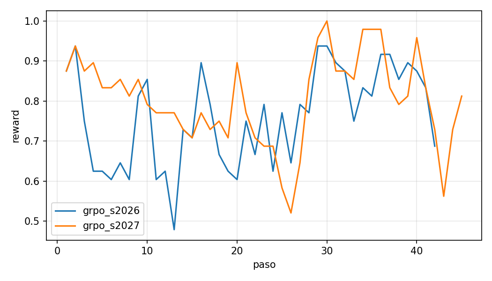

# Harness de razonamiento con herramientas sobre inventarios

Entorno, dataset y entrenamiento para IIC-3694 Inteligencia Artificial Generativa (PUC Chile). El repositorio cubre las dos partes del curso:

- **Desafío de Investigación** (terminado): un harness donde un modelo pequeño, de 1–2B de parámetros, resuelve solicitudes sobre inventarios combinando datos, comparando alternativas y aplicando restricciones. Incluye generador de tareas, verificador, línea base y datos para SFT y DPO.
- **Proyecto** (en curso): entrenar al modelo objetivo sobre ese entorno y comparar cinco caminos: modelo base, solo SFT, SFT seguido de GRPO, solo GRPO y DPO.

El modelo recibe una solicitud en español, consulta la herramienta `get_inventory` (o recibe los datos en el prompt) y responde. Un verificador independiente calcula la recompensa 0/1, que sirve a la vez para evaluar, filtrar trazas de SFT, armar pares de DPO y como recompensa de GRPO.

**Modelo objetivo:** `Qwen/Qwen3-1.7B` con thinking. **Profesor** para las trazas: `Qwen/Qwen3-8B` con thinking.

Integrantes: Tomás Ariztía, Arturo Herreros, Rodrigo Meza, Matías Retamales.

## Estado

### Desafío

| Entregable | Estado |
|---|---|
| Harness, generador de tareas y verificador | Listos. 334 casos adversariales, pasan 326 |
| Línea base del modelo objetivo | Lista: 900 rollouts de Qwen3-1.7B sobre `eval` (pass@1 y pass@5) |
| Línea base de otros modelos | Llama-3.2-1B, Qwen3-1.7B sin thinking y Qwen3-4B completas; Qwen3-0.6B en 70 de 90 instancias |
| Trazas SFT y pares DPO | 170 trazas y 106 pares (primera versión); 4.330 trazas y 148 pares (corrida grande con vLLM); 529 pares, 424 con rechazada del 1.7B (corrida parcial del 1.7B); **conjunto combinado: 4.664 trazas y 635 pares** |
| Informe | [docs/informe.md](docs/informe.md); versión revisada con figuras en [docs/informe_v2.md](docs/informe_v2.md) |

### Proyecto

| Hito | Fecha | Estado |
|---|---|---|
| Entrega 1: propuesta | 11 nov | [docs/propuesta_proyecto.md](docs/propuesta_proyecto.md) |
| Entrega 2: avance con línea base y primeras curvas | 25 nov | Piloto GRPO con dos semillas y curvas de recompensa. Estado en [docs/estado_entrega2.md](docs/estado_entrega2.md) |
| Entrega 3: paper, poster y video | 9 dic | Pendiente |

| Camino | Estado |
|---|---|
| 1. Modelo base | Medido (línea base) |
| 2. Solo SFT | Script listo; sin correr en GPU |
| 3. SFT seguido de GRPO | Script listo; sin correr |
| 4. Solo GRPO | Piloto en Kaggle con dos semillas ([resultados](results/grpo_kaggle/README.md)); falta medirlo en `eval` |
| 5. DPO | Script listo; sin correr en GPU |

## Línea base de Qwen3-1.7B

Qwen3-1.7B con thinking sobre `eval`: 10 instancias por celda, 5 muestras, 90 instancias por condición (`results/kaggle_qwen17b/linea_base_qwen17b`). Con 10 instancias por celda, los intervalos por celda son anchos; el detalle está en su `report.md`.

| Condición | pass@1 | pass@5 |
|---|---|---|
| Datos visibles | 58/90 (64 %) | 80/90 (89 %) |
| Con herramientas | 37/90 (41 %) | 62/90 (69 %) |

Por dificultad (pass@1 y pass@5, sobre 30 instancias):

| Dificultad | Visible pass@1 | Visible pass@5 | Herramientas pass@1 | Herramientas pass@5 |
|---|---|---|---|---|
| Easy | 27 | 30 | 19 | 30 |
| Medium | 18 | 28 | 13 | 22 |
| Hard | 13 | 22 | 5 | 10 |

Lectura:

- Las tareas caen en la zona aprendible: el acierto baja con la dificultad y pass@5 supera con claridad a pass@1 en ambas condiciones.
- Usar herramientas cuesta unos 23 puntos de pass@1 frente a tener los datos a la vista.
- Composición hard con herramientas queda en 0/10 incluso con 5 intentos, y con datos visibles en 2/10: ahí casi no hay señal para RL.
- En selección con herramientas, 47 de 150 respuestas vienen sin claves (`S2|29|0`) y se rechazan; leídas por posición, 32 tendrían los valores correctos. Es un problema de formato tras recibir los resultados, no de razonamiento.

Estos números se **reevaluaron** con `scripts/reevaluate.py` después de la corrida. El verificador rechazaba las respuestas con varios pares en una línea (`O1_atendidas: 33O1_pendientes: 6...`), y 56 de esas respuestas eran correctas. Ahora se aceptan (ver [docs/contrato.md](docs/contrato.md)). Antes del cambio, herramientas daba 27/90 en pass@1. Cada fila corregida conserva su veredicto original en `verdict_anterior`.

## Línea base de otros modelos

Mismas instancias de `eval` y 5 muestras (`results/kaggle_otros_modelos`, corrida con `notebooks/linea_base_otros_kaggle.ipynb`). Sin thinking el tope es de 768 tokens; con thinking, de 4096.

| Modelo | Visible pass@1 | Visible pass@5 | Herramientas pass@1 | Herramientas pass@5 |
|---|---|---|---|---|
| Llama-3.2-1B | 0/90 | 0/90 | 0/90 | 0/90 |
| Qwen3-0.6B con thinking (parcial) | 5/70 (7 %) | 18/70 (26 %) | 9/70 (13 %) | 18/70 (26 %) |
| Qwen3-1.7B sin thinking | 27/90 (30 %) | 51/90 (57 %) | 22/90 (24 %) | 42/90 (47 %) |
| **Qwen3-1.7B con thinking (objetivo)** | 58/90 (64 %) | 80/90 (89 %) | 37/90 (41 %) | 62/90 (69 %) |
| Qwen3-4B sin thinking | 67/90 (74 %) | 71/90 (79 %) | 64/90 (71 %) | 73/90 (81 %) |

Lectura:

- El acierto sube con el tamaño del modelo en ambas condiciones, así que las tareas distinguen capacidad.
- El thinking le da al 1.7B unos 34 puntos de pass@1 con datos visibles y 17 con herramientas.
- Qwen3-4B sin thinking supera al objetivo en pass@1, pero no en pass@5 con datos visibles: gana poco con más intentos. 142 de sus generaciones se cortaron en el tope de 768 tokens.
- Llama-3.2-1B no acierta ninguna de sus 900 respuestas: 699 no traen bloque `<answer>` y 430 generaciones llegan al tope de tokens.
- Composición hard sigue casi en cero para todos: Qwen3-4B logra 0/10 con datos visibles y 1/10 con herramientas.
- Qwen3-0.6B se cortó a las 11 horas con 70 de 90 instancias por condición, todas con sus 5 muestras. La corrida se puede continuar.

Qwen3-8B con thinking, el profesor, se midió solo sobre `train` (ver la sección siguiente), así que no es comparable punto a punto con esta tabla.

## Datos derivados

Los dos conjuntos se arman con `scripts/build_training_data.py`, que vuelve a verificar cada respuesta, descarta cualquier instancia igual a una de `eval` o `test` y deja el procedimiento y los conteos en `manifest.json`.

| Conjunto | Prompts de `train` | Trazas SFT | Pares DPO | Rechazada del par |
|---|---|---|---|---|
| `results/kaggle_qwen8b/datos_derivados_qwen8b` | 180 (90 instancias × 2 condiciones) | 170 | 106 | Qwen3-1.7B (105 pares) |
| `results/kaggle_qwen8b/datos_derivados_vllm` | 2.338 (1.170 instancias × 2 condiciones, 130 por celda) | 4.330 | 148 | Qwen3-8B |
| `results/kaggle_qwen17b/datos_derivados_dpo17b` | Los mismos 2.338; el 1.7B corrió 768 de ellos | (no versionado) | 529 | Qwen3-1.7B (424), Qwen3-8B (105) |
| **`results/datos_combinados`** (por omisión) | 2.516 (las cinco corridas) | 4.664 | 635 | Qwen3-1.7B (529), Qwen3-8B (106) |

La traza correcta es de Qwen3-8B salvo excepciones contadas (1 par de `datos_derivados_dpo17b`; 9 trazas SFT del combinado).

**Conjunto combinado (por omisión).** `train_sft.py` y `train_dpo.py` usan por omisión `results/datos_combinados`, armado con las cinco corridas sobre `train`: las dos iniciales (1.7B y 8B, 10 por celda), las dos partes del 8B con vLLM y la corrida parcial del 1.7B. Los otros tres conjuntos se mantienen sin cambios para poder volver a otra configuración con `--data`.

- `sft.jsonl`: 4.664 trazas, hasta 2 por prompt (2.362 de `visible` y 2.302 de `tools`), sobre 2.255 prompts con alguna respuesta correcta. El 8B tiene prioridad y casi siempre llena los dos cupos, así que solo entran 9 trazas del 1.7B. Para sumar sus 1.006 trazas correctas habría que subir `--max-sft-per-prompt` a 4.
- `dpo.jsonl`: 635 pares, uno por prompt (262 de `visible` y 373 de `tools`); 529 con la rechazada del 1.7B y 106 con la del 8B. `dpo_17b.jsonl` trae solo los 529 del 1.7B y contiene a los 424 de `datos_derivados_dpo17b`.
- Ningún prompt está en `eval` ni en `test`: el script excluye 8 respuestas y se comprobó aparte con los prompts renderizados.
- Dos prompts tienen trazas del 8B de dos corridas con el mismo `sample`, así que comparten `id` en `sft.jsonl`. Son respuestas distintas y el entrenamiento no usa el `id`.

```bash
uv run python scripts/build_training_data.py \
  results/kaggle_qwen17b/trazas_qwen17b results/kaggle_qwen8b/trazas_qwen8b \
  results/kaggle_qwen8b/trazas_qwen8b_vllm_parte1de2 results/kaggle_qwen8b/trazas_qwen8b_vllm_parte2de2 \
  results/kaggle_qwen17b/trazas_qwen1.7b_vllm --out results/datos_combinados --max-sft-per-prompt 2
jq -c 'select(.rejected_model=="Qwen/Qwen3-1.7B+think")' results/datos_combinados/dpo.jsonl > results/datos_combinados/dpo_17b.jsonl
```

**Primera versión.** Qwen3-8B corrió los 180 prompts con 2 muestras y acertó 329 de 360 respuestas. Los 10 prompts sin respuesta correcta son todos de composición hard. En DPO, la rechazada es del modelo objetivo, y 83 de las 106 son errores de valor.

**Corrida grande con vLLM.** 4.680 rollouts del 8B, repartidos en dos cuentas de Kaggle (`trazas_qwen8b_vllm_parte1de2` y `parte2de2`), a unos 7,5 s por rollout frente a 40–100 s con `transformers`. Se descartaron 4 instancias iguales a `eval` o `test`. El 8B acertó 4.337 de 4.680 respuestas, casi todas salvo en composición: en hard, pass@1 es 52 % con herramientas y 55 % con datos visibles (130 instancias cada una). Diferencias con la primera versión que conviene tener presentes:

- Las rechazadas de DPO son errores del propio 8B, no del 1.7B, y se concentran en composición (122 de 148 pares).
- Las trazas de `tools` usan el formato de herramienta en texto. Si se adopta el formato nativo ([docs/auditoria_tool_calling.md](docs/auditoria_tool_calling.md)), hay que convertirlas.
- Para entrenar con esta versión en vez del conjunto combinado hay que pasar `--data results/kaggle_qwen8b/datos_derivados_vllm/sft.jsonl` (o `dpo.jsonl`).

**Pares DPO con rechazada del 1.7B (corrida parcial).** Qwen3-1.7B con thinking corrió en Colab, con vLLM en una T4, sobre los mismos prompts que el 8B (`results/kaggle_qwen17b/trazas_qwen1.7b_vllm`, el mismo código `c0d1e2342820d4c2`). La sesión se cortó a las 4,5 horas, con 1.536 de 4.680 rollouts (10,1 s por rollout): 384 instancias (unas 21 por celda) con las dos condiciones y las dos muestras, así que la muestra queda pareja entre celdas. El 1.7B acertó 829 de 1.536 (54 %); 72 respuestas se cortaron en el tope, 46 de ellas en composición hard, donde acierta 2 de 168.

`build_training_data.py` sobre las dos partes del 8B y esta corrida da 529 pares: 424 con rechazada del 1.7B y 105 con rechazada del 8B en prompts que el 1.7B no corrió. `dpo_17b.jsonl` trae solo los 424 del 1.7B:

- 248 de `tools` y 176 de `visible`; 162 de composición, 141 de disponibilidad y 121 de selección; 166 hard, 160 medium y 98 easy.
- 343 son errores de valor (`wrong_value`) y 33 de campo desconocido (`unknown_field`, un problema de formato).
- Medidos en caracteres (unos 3,3 por token), cerca de 65 pares superan los 4.096 tokens en alguno de sus lados y `train_dpo.py` los trunca con su `--max-length` por omisión.
- `sft.jsonl` de esta carpeta no se versiona: repite las 4.330 trazas de `datos_derivados_vllm` y suma solo 8 del 1.7B. Se regenera con el comando de abajo.

```bash
uv run python scripts/build_training_data.py \
  results/kaggle_qwen8b/trazas_qwen8b_vllm_parte1de2 results/kaggle_qwen8b/trazas_qwen8b_vllm_parte2de2 \
  results/kaggle_qwen17b/trazas_qwen1.7b_vllm --out results/kaggle_qwen17b/datos_derivados_dpo17b --max-sft-per-prompt 2
jq -c 'select(.rejected_model=="Qwen/Qwen3-1.7B+think")' results/kaggle_qwen17b/datos_derivados_dpo17b/dpo.jsonl \
  > results/kaggle_qwen17b/datos_derivados_dpo17b/dpo_17b.jsonl
```

## Entrenamiento

`scripts/train_sft.py`, `train_dpo.py` y `train_grpo.py` entrenan a Qwen3-1.7B con LoRA, y `run_pilot.py --stage eval_final --adapter ...` mide el resultado con el mismo protocolo y las mismas 90 instancias de `eval` que la línea base. Los pasos, los argumentos y los límites están en [docs/guia_entrenamiento.md](docs/guia_entrenamiento.md); las versiones probadas, en `requirements-train.txt`. GRPO entrena solo en la condición `visible`.

### Piloto GRPO (camino 4)

Qwen3-1.7B desde el modelo base, en `visible` con easy y medium, 2 problemas por paso y 8 respuestas por problema, 150 minutos por semilla en una T4 de Kaggle (`notebooks/grpo_curva_kaggle.ipynb`). Detalle, curvas y adaptadores en [results/grpo_kaggle/README.md](results/grpo_kaggle/README.md).

| Semilla | Pasos | Recompensa, primer → último tercio | Grupos sin señal | Respuestas cortadas |
|---|---|---|---|---|
| 2026 | 42 | 68 % → 83 % | 44 % | 10 % |
| 2027 | 45 | 81 % → 84 % | 58 % | 11 % |



Lectura:

- El entorno da señal: cerca de la mitad de los grupos mezclan aciertos y errores.
- La curva es ruidosa, porque cada paso usa solo 2 problemas, y son tasas sobre `train`. Si el modelo mejoró solo se sabrá midiendo los adaptadores en `eval` (`notebooks/evaluar_grpo_kaggle.ipynb`).
- La recompensa ya parte en 75–80 % en easy y medium, así que muchos grupos aciertan las 8 respuestas y no aportan gradiente.
- `train_grpo.py` no fija `loss_type`, así que TRL 1.18.2 usó `"dapo"`, y `beta=0` (sin KL). Hay que fijarlo explícitamente antes de las corridas comparables.

Los adaptadores están en `results/grpo_kaggle/resultados_grpo.zip`, con Git LFS: `git lfs install && git lfs pull`.

## Instalación

Requiere Python 3.10 o superior y [uv](https://docs.astral.sh/uv/).

```bash
git clone https://github.com/tariztia/harness-inventarios.git
cd harness-inventarios
uv run --group dev pytest -q
```

Deberían pasar todos los tests, salvo 8 marcados como `xfail`, que son limitaciones conocidas del verificador. La suite completa es lenta en Windows. El núcleo solo usa la biblioteca estándar; `torch` y `transformers` hacen falta para correr modelos, y `pip install -r requirements-train.txt` instala lo necesario para entrenar.

## Uso

### Generar un dataset

```bash
uv run python scripts/generate_dataset.py --n-per-cell 40 --base-seed 2026 --out data
```

Crea `train.jsonl`, `eval.jsonl`, `test.jsonl` y `stats.json`. La misma semilla produce el mismo dataset, por eso `data/` no se versiona. No cambies `--n-per-cell` para `eval`: cambia las instancias y deja de ser comparable con la línea base. Para más prompts de entrenamiento está `scripts/make_train_prompts.py`.

### Usar la recompensa

La interfaz común del curso es `reward(prompt, completion) -> float`:

```python
from inventory_harness.generator import generate_instance
from inventory_harness.prompts import render_prompt
from inventory_harness.reward import InstanceStore, make_reward

instance = generate_instance("availability", "easy", "train", 7)
reward = make_reward(InstanceStore([instance]))

prompt = render_prompt(instance, "visible")
print(reward(prompt, "<answer>\nalcanza: sí\nfaltan: 999\n</answer>"))  # 0.0
```

Para un dataset guardado, usa `InstanceStore.from_jsonl("data/eval.jsonl")`.

En la condición con herramientas, `completion` es la trayectoria completa serializada como JSON. El harness repite cada llamada contra el estado protegido, así que una observación inventada o una respuesta adivinada recibe 0. El detalle está en [docs/contrato.md](docs/contrato.md).

### Correr modelos (Colab y Kaggle)

No hace falta GPU local. Todos los cuadernos usan el zip de código que genera `uv run python scripts/package_for_colab.py`, y las corridas se reanudan si la sesión se corta.

| Cuaderno | Para qué |
|---|---|
| `notebooks/qwen_objetivo_colab.ipynb`, `qwen_objetivo_kaggle.ipynb` | Línea base del objetivo en `eval` y sus respuestas en `train` |
| `notebooks/qwen_profesor_kaggle.ipynb` | Trazas del 8B, con `transformers` o vLLM, repartibles entre cuentas (`SHARD`) |
| `notebooks/linea_base_otros_kaggle.ipynb` | Línea base de los otros modelos |
| `notebooks/grpo_curva_kaggle.ipynb`, `evaluar_grpo_kaggle.ipynb` | Piloto GRPO y evaluación de sus adaptadores |
| `notebooks/tools_nativo_colab.ipynb` | Prueba del formato nativo de herramientas |
| `notebooks/piloto_colab.ipynb` | Exploración inicial |

Guías: [docs/guia_colab.md](docs/guia_colab.md) y [docs/guia_kaggle.md](docs/guia_kaggle.md).

Las respuestas sobre `train` se convierten en datos de entrenamiento con:

```bash
uv run python scripts/build_training_data.py results/trazas --out results/datos_derivados
```

Acepta varias carpetas; las respuestas de Qwen3-8B tienen prioridad como correctas. Rechaza cualquier corrida que no sea de `train`. Si se corrige el verificador, `scripts/reevaluate.py` vuelve a evaluar los rollouts guardados.

### Probar y analizar sin GPU

```bash
uv run python scripts/run_pilot.py --stage exploracion --dry-run --limit 9 --n-samples 1 --out /tmp/prueba
uv run python scripts/analyze_results.py /tmp/prueba
```

`--dry-run` usa un modelo simulado: sirve para probar el código, no para medir. `analyze_results.py` escribe `report.md`, `summary.json` y `muestra_errores.jsonl` en la carpeta indicada.

## El problema

Hay tres familias de tareas, con tres niveles cada una. Las reglas exactas están en [docs/reglas_negocio.md](docs/reglas_negocio.md).

| Familia | Pregunta | Qué exige |
|---|---|---|
| Disponibilidad | ¿Alcanza el stock para un pedido? ¿Cuánto falta? | Consultar, restar reservas y comparar |
| Selección | ¿Qué sucursal cubre más de un pedido? | Comparar sucursales y desempatar |
| Composición | ¿Cómo se reparten varios pedidos en orden de llegada? | Descontar stock entre pedidos |

Cada tarea se evalúa en dos condiciones, para separar la dificultad de razonar de la de usar herramientas:

- `tools`: el modelo debe obtener los datos con `get_inventory`, con un máximo de dos rondas.
- `visible`: los datos van en el prompt.

La respuesta final es texto libre seguido de un bloque:

```text
<answer>
alcanza: no
faltan: 3
</answer>
```

El verificador acepta formas equivalentes como `3`, `tres`, `20-17` o `1 de P01 y 2 de P02`. Rechaza respuestas múltiples, ambiguas o contradictorias. La suite adversarial tiene 334 casos y pasa 326; los resultados y las 8 limitaciones están en [docs/robustez_verificador.md](docs/robustez_verificador.md). Esos casos los escribió el equipo, así que no reemplazan revisar respuestas reales: la auditoría con respuestas reales está en [docs/auditoria_verificador.md](docs/auditoria_verificador.md).

## Estructura

```text
src/inventory_harness/
  generator.py, templates.py   generan las tareas
  solver.py                    calcula la respuesta correcta
  verifier.py, numbers_es.py   analizan y verifican la respuesta final
  tools.py, prompts.py         herramienta y mensajes del modelo
  rollout.py, backends.py      ejecutan modelos (transformers o vLLM), con lotes y reanudación
  reward.py                    interfaz reward(prompt, completion)
  training_data.py             trazas SFT y pares DPO a partir de rollouts
  training_prep.py             tokenización y recompensa para SFT, DPO y GRPO
  metrics.py, baselines.py     pass@k, intervalos y reglas triviales
scripts/
  generate_dataset.py, make_train_prompts.py   datasets
  run_pilot.py, analyze_results.py             correr modelos y resumir
  build_training_data.py, reevaluate.py        datos derivados y reevaluación
  train_sft.py, train_dpo.py, train_grpo.py    entrenamiento con LoRA
  plot_training.py, audit_sample.py            curvas y muestra para auditoría manual
notebooks/                     Colab y Kaggle (tabla de arriba)
tests/                         tests y casos adversariales
results/
  exploracion_*                corridas iniciales del Desafío
  kaggle_qwen17b/              línea base y trazas del objetivo
  kaggle_otros_modelos/        línea base de los otros modelos
  kaggle_qwen8b/               trazas del profesor y datos derivados
  grpo_kaggle/                 piloto GRPO: curvas, métricas y adaptadores
docs/                          ver la sección siguiente
docs/propuesta/                enunciados del Desafío y del Proyecto, y propuestas del Desafío
```

## Documentación

| Documento | Contenido |
|---|---|
| [docs/informe.md](docs/informe.md), [docs/informe_v2.md](docs/informe_v2.md) | Informe del Desafío y su revisión |
| [docs/propuesta_proyecto.md](docs/propuesta_proyecto.md) | Propuesta del Proyecto: caminos, diseño experimental y plan |
| [docs/estado_entrega2.md](docs/estado_entrega2.md) | Estado y plan hasta la entrega final |
| [docs/guia_entrenamiento.md](docs/guia_entrenamiento.md) | Cómo entrenar y evaluar cada camino |
| [docs/auditoria_tool_calling.md](docs/auditoria_tool_calling.md) | Formato de herramientas en texto o nativo: análisis y recomendación |
| [docs/contrato.md](docs/contrato.md), [docs/reglas_negocio.md](docs/reglas_negocio.md) | Formato de interacción y reglas de las tareas |
| [docs/robustez_verificador.md](docs/robustez_verificador.md), [docs/auditoria_verificador.md](docs/auditoria_verificador.md), [docs/analisis_verificador.md](docs/analisis_verificador.md) | Robustez del verificador |
| [docs/guia_colab.md](docs/guia_colab.md), [docs/guia_kaggle.md](docs/guia_kaggle.md) | Cómo correr en Colab y Kaggle |

## Próximos pasos

El plan completo está en [docs/estado_entrega2.md](docs/estado_entrega2.md) y en la sección 5 de [docs/propuesta_proyecto.md](docs/propuesta_proyecto.md). Lo inmediato:

1. Medir los adaptadores del piloto GRPO en `eval` con el mismo protocolo de la línea base.
2. Fijar `loss_type` en `train_grpo.py` antes de las corridas comparables.
3. Correr SFT (con los datos de vLLM), DPO y SFT seguido de GRPO, y fijar el presupuesto de cómputo comparable entre caminos.
4. Decidir el formato de `tools` (texto o nativo), porque afecta a las 2.138 trazas de `tools`.
5. Auditoría manual de trazas exitosas con `scripts/audit_sample.py`.
