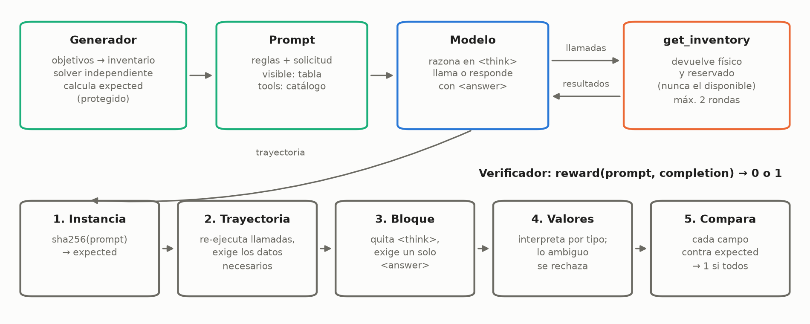
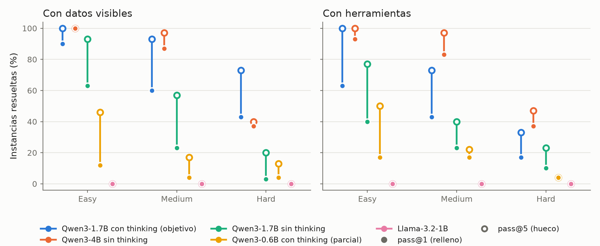

# Harness de razonamiento con herramientas sobre inventarios

**Desafío de Investigación, IIC-3694 Inteligencia Artificial Generativa (PUC Chile)**

Integrantes: _(completar)_

Código, datos y resultados: _(link al repositorio público, por completar)_. Las rutas que cita este informe son relativas a ese repositorio.

## 1. Introducción

El desafío pide construir un entorno de entrenamiento (harness) y su dataset para que un modelo de lenguaje pequeño, de 1–2B de parámetros, mejore en razonamiento o uso de herramientas. Las tareas deben tener respuestas verificables por código y caer en la zona aprendible del modelo objetivo, de modo que el verificador sirva después como recompensa para aprendizaje por refuerzo. Seguimos la línea de los entornos procedurales con verificación en código, como Reasoning Gym (Stojanovski et al., 2025).

Elegimos solicitudes sobre el inventario de una cadena de sucursales. El modelo recibe una solicitud en español, consulta el stock con una herramienta y entrega una respuesta que el verificador califica con 0 o 1. Las tareas exigen restar reservas, comparar sucursales y repartir stock entre pedidos que compiten. La herramienta entrega datos y nunca la respuesta, así que acertar exige razonar sobre lo que devuelve. El modelo objetivo es Qwen3-1.7B con thinking.

Los resultados principales son:

- **Las tareas caen en la zona aprendible del objetivo.** Usando herramientas acierta 41 % al primer intento y 69 % en alguno de 5 intentos. Con los datos a la vista, 64 % y 89 %.
- **La dificultad está graduada y el entorno distingue capacidad.** Con herramientas, el pass@1 del objetivo baja de 63 % en easy a 43 % en medium y 17 % en hard. Sobre las mismas instancias, Llama-3.2-1B acierta 0 %, Qwen3-1.7B sin thinking 24 % y Qwen3-4B sin thinking 71 %.
- **El verificador resiste las trampas que previmos y se corrigió con respuestas reales.** Pasa 326 de 334 casos adversariales escritos por el equipo, y ninguno de los 8 fallos premia un valor incorrecto. Una auditoría de respuestas reales encontró un falso rechazo frecuente, que se corrigió. Esto no garantiza robustez frente a un modelo optimizado con RL, que solo se podrá medir al entrenar.
- **Los datos derivados están listos:** 170 trazas SFT de Qwen3-8B y 106 pares DPO sobre 180 prompts de entrenamiento.

Las debilidades principales son que composición hard casi no da señal en ningún modelo medido, que la línea base usa 10 instancias por celda, y que la herramienta se describe en texto en lugar de usar el mecanismo nativo de llamadas de los modelos (sección 8).

## 2. Entorno

### 2.1 Tareas

Cada instancia tiene un inventario sintético: un registro por cada par producto × sucursal, con stock físico y stock reservado. La regla central es **disponible = stock físico − reservado**. Hay tres familias:

| Familia | Pregunta | Qué exige | Campos de la respuesta |
|---|---|---|---|
| Disponibilidad | ¿Alcanza el stock de una sucursal para un pedido? ¿Cuánto falta? | Restar reservas, comparar por línea y sumar faltantes | `alcanza`, `faltan` |
| Selección | ¿Qué sucursal cubre más unidades de un pedido? | Calcular la cobertura de cada sucursal, comparar y desempatar por ID | `sucursal`, `cubiertas`, `pendientes` |
| Composición | ¿Cómo se reparten varios pedidos que llegan en orden? | Descontar el stock ya asignado a pedidos anteriores | `Ok_atendidas` y `Ok_pendientes` por pedido, `total_pendientes` |

Todas las reglas van escritas en el prompt (`docs/reglas_negocio.md`). Los datos son sintéticos y cambian en cada instancia, así que el problema es de razonamiento y uso de herramientas, no de memorización.

### 2.2 Dos condiciones

Cada instancia se evalúa en dos condiciones, para separar la dificultad de razonar de la de usar herramientas. En **`visible`** la tabla de inventario va en el prompt. En **`tools`** el modelo debe pedir los datos con `get_inventory(product_id, location_id=None)`, que devuelve el stock físico y el reservado, nunca el disponible ni datos del pedido.

### 2.3 Protocolo de interacción

El prompt es un único mensaje de usuario con las reglas, el catálogo y la solicitud (Anexo A). La herramienta se describe en ese mismo texto, con un ejemplo de llamada. Es una decisión de portabilidad: un prompt en texto plano sirve a cualquier modelo. Los modelos que usamos sí tienen un formato nativo de llamadas (las plantillas de Qwen3 y de Llama 3.2 aceptan una lista de herramientas), y no usarlo tiene un costo que discutimos en la sección 8.

En `tools` la interacción tiene pocos turnos, como recomienda el enunciado. El modelo emite una o más llamadas `<tool_call>{json}</tool_call>`; el harness las ejecuta y responde con los resultados y recién ahí con el formato de respuesta (cuando el formato iba en el prompt inicial, los modelos respondían sin llamar). El modelo responde o pide una segunda ronda; una tercera no se ejecuta y vale 0. El harness también acepta llamadas sin la etiqueta, como un JSON suelto que nombre la herramienta, para que la línea base mida qué datos pide el modelo y no si recuerda una sintaxis. El Anexo A detalla qué cuenta como llamada y los riesgos de esa flexibilidad.

La respuesta final es texto libre seguido de exactamente un bloque `<answer>`, que es obligatorio, con un par `clave: valor` por campo o un objeto JSON plano:

```text
<answer>
sucursal: S2
cubiertas: 7
pendientes: 1
</answer>
```

Fuera del bloque no se busca la respuesta, porque el texto libre trae cálculos intermedios (`faltan: 5` antes de corregirse a `faltan: 3`) y elegir uno sería adivinar.

### 2.4 Interfaz del curso

El entorno expone `reward(prompt: str, completion: str) -> float`:

```python
from inventory_harness.reward import InstanceStore, make_reward

reward = make_reward(InstanceStore.from_jsonl("data/eval.jsonl"))
reward(prompt, completion)  # 0.0 o 1.0
```

El `sha256` del prompt es la clave con que el harness encuentra la instancia y su respuesta esperada en un almacén protegido; el prompt no contiene la respuesta. `completion` es un solo mensaje del modelo o la trayectoria completa en JSON, con las observaciones. Un prompt desconocido vale 0 y la función nunca lanza una excepción. El núcleo usa solo la biblioteca estándar de Python (contrato en `docs/contrato.md`). La Figura 1 resume el flujo.



**Figura 1.** Flujo del entorno. El generador fija la respuesta esperada al crear la instancia; el verificador recibe la trayectoria y compara contra ella.

## 3. Dataset

### 3.1 Generación

Las instancias se generan por código, sin intervención manual. Se fijan objetivos (por ejemplo, si el pedido alcanza o qué sucursal gana), se propone un inventario al azar que apunte a ellos, un solucionador independiente, que no comparte código con el generador, calcula la respuesta esperada y, si no se cumplen los objetivos, se reintenta. Todo es determinista: la semilla de cada instancia se deriva con SHA-256, así que basta versionar el código. La solicitud se redacta con una de 5 plantillas por familia.

### 3.2 Controles contra atajos

Una instancia es degenerada si un atajo la resuelve sin razonar. Si la mayoría de las instancias de disponibilidad alcanzaran, por ejemplo, un modelo que siempre responde «sí» acertaría sin calcular, y el aprendizaje por refuerzo premiaría ese atajo. Para medirlo, el generador resuelve una versión trampa de cada instancia (sin reservas, con el orden de los pedidos invertido, eligiendo por stock físico) y la compara con la respuesta real. Cada fila de la tabla dice con qué frecuencia el atajo da otra respuesta, es decir, cuánto falla. Sobre el dataset de 1.080 instancias:

| Familia | Control | Valor medido |
|---|---|---|
| Disponibilidad | El pedido alcanza | 50 % |
| Disponibilidad | Ignorar las reservas cambia la respuesta | 50 % (cambia `alcanza` en 28–38 %) |
| Selección | Hay empate entre sucursales | 13–19 % |
| Selección | Elegir por stock físico da otra sucursal | 73–83 % |
| Selección | Posición de la sucursal ganadora | Repartida entre todas las posiciones |
| Composición | Hay escasez | 81–88 % |
| Composición | Ignorar el orden de llegada cambia el resultado | 81–93 % |
| Composición hard | Se usa la cascada entre sucursales | 100 % |

Como segundo control, la línea base compara a los modelos con reglas triviales sobre las mismas instancias (sección 6 y Anexo E).

### 3.3 Particiones y tamaño

Hay tres particiones, `train`, `eval` y `test`, sin instancias duplicadas entre ellas. La mitad de `test` usa una plantilla de redacción reservada, para medir generalización; no se usó en este informe. La configuración estándar genera 40 instancias por celda (familia × dificultad × partición), 1.080 en total; para la línea base y las trazas usamos 10 por celda, por costo de cómputo.

### 3.4 Niveles de dificultad

| Familia | Easy | Medium | Hard |
|---|---|---|---|
| Disponibilidad | 1 línea | 2 líneas | 3–4 líneas |
| Selección | 1 línea, 2–3 sucursales | 2 líneas, 3 sucursales | 3–4 líneas, 4–5 sucursales |
| Composición | 2 pedidos, 1 producto, 1 sucursal | 3 pedidos, 2 productos, 1–2 sucursales | 4–5 pedidos, 3 productos, 2–3 sucursales, con cascada |

Los niveles se definieron antes de medir, a partir de la estructura de la tarea.

## 4. Verificador

El verificador no juzga el razonamiento: **compara valores**. La respuesta esperada la calculó el solucionador al generar la instancia, y el verificador solo tiene que leer qué respondió el modelo y compararlo campo por campo. Por eso puede ser código determinista, sin un modelo de lenguaje como juez. Un juez sería más flexible con formas de respuesta imprevistas, pero agrega una pasada de modelo por cada rollout y se puede engañar: respuestas triviales logran tasas altas de falsos positivos en jueces grandes (Zhao et al., 2025). El costo de las reglas es el contrario, rechazar formas correctas que nadie previó (Huang et al., 2025). Lo aceptamos, y lo mitigamos con la auditoría de la sección 4.4.

### 4.1 Cómo lee la respuesta

El verificador descarta el contenido de `<think>`, exige exactamente un bloque `<answer>` con todos los campos y sin campos desconocidos o repetidos, y luego interpreta cada valor según su tipo: entero, sí/no o sucursal. Para los enteros hay una gramática escrita a mano que acepta, por ejemplo, `3`, `tres`, `3 unidades`, `20-17` y `cuatro filas de 10`, como pide el enunciado. Su principio es **rechazar todo lo que admita más de una lectura**: `3 o 4`, `unos 3` y `3 (cuatro)` valen 0, y nunca se extrae «el primer número» de un texto. Finalmente compara cada campo con la respuesta esperada y entrega 1 solo si todos coinciden. Cada rechazo lleva un tipo de error, que se usa para el diagnóstico y para elegir los pares DPO.

En la práctica los modelos casi no usaron esas equivalencias: de las 1.918 respuestas correctas de la línea base y de las trazas, ninguna usa números en palabras, grupos o sumas. Las mantenemos porque el enunciado las pide y porque al entrenar la política puede derivar hacia formas inusuales, aunque cada regla permisiva es superficie de ataque (Anexo B).

### 4.2 Defensas en la trayectoria

En `tools`, la trayectoria que llega en `completion` podría estar falsificada, así que el verificador no confía en ella:

1. **Repetición:** vuelve a ejecutar cada llamada contra el estado protegido. Si una observación registrada difiere de la real, la recompensa es 0.
2. **Evidencia:** las observaciones reales deben cubrir los registros necesarios para resolver la instancia. Una respuesta correcta sin haber pedido los datos vale 0, para no premiar la adivinación.
3. **Límite:** aplica el máximo de 2 rondas de herramientas.

### 4.3 Casos adversariales

Escribimos 334 casos para engañar al verificador o comprobar que acepta equivalencias: varias respuestas a la vez, homoglifos, desbordes numéricos, copia de la salida de la herramienta, inyección de instrucciones, entre otros. El verificador da el veredicto esperado en 326. Uno de los 8 fallos es un falso rechazo (`3 filas de 10 y 5 sueltas`); los otros 7 son contradicciones en la prosa que no se detectan, con el bloque correcto en todos sus campos, así que ningún fallo premia un valor incorrecto. Hay que leer esta cifra con cuidado: los casos los escribió el mismo equipo que hizo el verificador, así que miden las trampas que imaginamos. El Anexo C tiene la tabla por categoría con un ejemplo de cada una.

### 4.4 Auditoría y corrección

Para ver respuestas que no escribimos nosotros, revisamos a mano las de dos corridas exploratorias, sobre 45 instancias de `train` (Anexo D). De 119 respuestas aceptadas, ninguna era incorrecta. De 455 rechazadas, 9 eran correctas pero se rechazaron por la forma: valores entre `< >` y varios pares en una misma línea.

La segunda causa resultó mucho más frecuente en la línea base con herramientas: el objetivo escribía `O1_atendidas: 33O1_pendientes: 6...`, y 56 de esas respuestas eran correctas. Corregimos el verificador para separar pares en una línea solo donde aparece una clave del contrato seguida de dos puntos, de modo que `33O1_pendientes:` no se puede leer como 3301 (Anexo B), y reevaluamos los rollouts guardados sin volver a correr el modelo. El pass@1 con herramientas del objetivo pasó de 27/90 a 37/90, y cada fila corregida conserva su veredicto original.

Es el ciclo que describe el enunciado: revisar trazas, corregir el verificador y volver a medir. También es una relajación decidida después de ver resultados. La justificamos porque esa forma tiene una sola lectura posible; con el mismo criterio seguimos rechazando respuestas sin claves como `S2|29|0`, cuyo significado depende de la posición.

## 5. Línea base

### 5.1 Configuración

| Modelo | Parámetros | Thinking | Tope de tokens | Instancias por condición |
|---|---|---|---|---|
| Llama-3.2-1B-Instruct | 1,2B | No tiene | 768 | 90 |
| Qwen3-0.6B | 0,6B | Sí | 4.096 | 70 (corrida parcial) |
| Qwen3-1.7B | 1,7B | No | 768 | 90 |
| **Qwen3-1.7B (objetivo)** | 1,7B | Sí | 4.096 | 90 |
| Qwen3-4B | 4B | No | 768 | 90 |

Todas las corridas usan la partición `eval` con 10 instancias por celda y 5 muestras por instancia, con temperatura 0,7, `top_p` 0,95, `top_k` 50 y semilla fija, en GPU T4 de Kaggle. Un **rollout** es un intento completo calificado con 0 o 1; en total son 4.300.

- **pass@1** usa la primera muestra de cada instancia, y **pass@5** cuenta las instancias con al menos un acierto entre sus 5 muestras (Chen et al., 2021).
- Para pass@1 reportamos intervalos de confianza de Wilson al 95 % (Wilson, 1927), sobre instancias.
- El **tope de tokens** es el máximo de tokens generados por mensaje, razonamiento de `<think>` incluido. En `tools`, cada turno tiene su propio tope.

Hay tres salvedades. La corrida de Qwen3-0.6B se cortó por el límite de tiempo de Kaggle con 70 de 90 instancias por condición, repartidas de forma pareja entre las celdas. Los modelos sin thinking tienen un tope menor, así que la comparación entre ambos grupos no es del todo pareja: afecta sobre todo a Qwen3-4B (sección 5.4). Y no medimos un modelo más grande con thinking sobre `eval`; el profesor Qwen3-8B corrió sobre `train` (sección 7).

### 5.2 Resultados

| Modelo | Visible pass@1 | Visible pass@5 | Herramientas pass@1 | Herramientas pass@5 |
|---|---|---|---|---|
| Llama-3.2-1B | 0/90 (0 %; IC 0–4) | 0/90 (0 %) | 0/90 (0 %; IC 0–4) | 0/90 (0 %) |
| Qwen3-0.6B con thinking | 5/70 (7 %; IC 3–16) | 18/70 (26 %) | 9/70 (13 %; IC 7–23) | 18/70 (26 %) |
| Qwen3-1.7B sin thinking | 27/90 (30 %; IC 22–40) | 51/90 (57 %) | 22/90 (24 %; IC 17–34) | 42/90 (47 %) |
| **Qwen3-1.7B con thinking** | 58/90 (64 %; IC 54–74) | 80/90 (89 %) | 37/90 (41 %; IC 32–51) | 62/90 (69 %) |
| Qwen3-4B sin thinking | 67/90 (74 %; IC 65–82) | 71/90 (79 %) | 64/90 (71 %; IC 61–79) | 73/90 (81 %) |

El acierto sube con el tamaño del modelo en ambas condiciones. El thinking le da a Qwen3-1.7B unos 34 puntos de pass@1 con datos visibles y 17 con herramientas, y para el objetivo usar herramientas cuesta 23 puntos de pass@1 frente a tener los datos a la vista. Qwen3-4B sin thinking supera al objetivo en pass@1, pero gana poco con más intentos: tiende a acertar o fallar una instancia en todas sus muestras.



**Figura 2.** pass@1 (punto relleno) y pass@5 (punto hueco) por nivel de dificultad, sobre 30 instancias por nivel (23 o 24 para Qwen3-0.6B). La línea entre ambos es lo que se gana con 5 intentos. Las cifras están en el Anexo E.

En todos los modelos que aciertan algo, el acierto baja de easy a hard (Figura 2), lo que confirma el orden de los niveles definidos antes de medir. Composición es la familia más difícil, y composición hard casi no tiene aciertos en ningún modelo: Qwen3-4B logra 0/10 con datos visibles y 1/10 con herramientas. Con 10 instancias por celda, las cifras por familia orientan pero no permiten comparar celdas vecinas: 6/10 corresponde a un intervalo de 31–83 % (Anexo E).

### 5.3 Errores del objetivo con herramientas

De las 450 respuestas de Qwen3-1.7B con thinking en `tools`, 168 son correctas (37 %) y 165 tienen un valor incorrecto (37 %); el resto son respuestas sin claves (47), sin bloque (36) y otros errores de formato o de protocolo (Anexo E). El modelo casi siempre sabe llamar: entre 84 % y 100 % de sus respuestas tienen llamadas válidas, según la celda, aunque solo 41 de las 450 usan la etiqueta `<tool_call>`. Lo que falla en las tareas difíciles es pedir todos los datos: en composición hard solo 34 % de las respuestas reunió los registros requeridos, frente a 94 % en composición easy. De los 282 fallos, 122 son errores de cálculo con llamadas válidas y todos los datos reunidos.

Una parte de los fallos es de formato, no de razonamiento. En selección con herramientas, 47 de las 150 respuestas vienen sin claves (`<answer>S2|29|0</answer>`), y leídas por posición 32 tendrían los valores correctos. Ocurre solo en esa familia y condición. El costo medio del objetivo es de 2.086 tokens y 55 s por respuesta con herramientas, y menos del 4 % de sus respuestas llegó al tope de tokens.

### 5.4 Otros modelos

- **Qwen3-4B sin thinking** se queda sin tokens en las tareas largas: 142 de sus 900 respuestas se cortan en el tope de 768 antes de emitir el bloque, todas en selección hard, composición hard y composición medium. Eso explica 142 de sus 269 fallos, así que sus cifras en hard subestiman lo que haría con más tokens.
- **Llama-3.2-1B** no acierta ninguna de sus 900 respuestas, y 699 no traen bloque `<answer>`. Pero su problema principal es el cálculo: buscando las claves en cualquier parte del texto, solo 14 % de los valores que escribe son correctos, frente a 49 % de Qwen3-1.7B sin thinking; por ejemplo, suma las reservas en vez de restarlas. Sí llama bien a la herramienta: 364 de sus 450 respuestas en `tools` tienen llamadas válidas.

El Anexo F tiene ejemplos reales de aciertos y errores de cada modelo.

## 6. Calibración para el modelo objetivo

El enunciado pide que las tareas no sean imposibles ni triviales para el objetivo. La evidencia es:

- **Acierto intermedio.** El pass@1 global es de 41 % con herramientas y 64 % con datos visibles.
- **Señal para RL.** pass@5 supera a pass@1 por 28 puntos con herramientas y 25 con datos visibles: el modelo ya produce respuestas correctas con cierta frecuencia, que es lo que el aprendizaje por refuerzo puede reforzar.
- **Gradiente de dificultad.** El acierto baja de easy a hard en ambas condiciones.
- **Margen de mejora.** Qwen3-4B alcanza 71 % con herramientas sin thinking, y Qwen3-8B con thinking resuelve 170 de los 180 prompts de `train`.
- **No basta un atajo.** El objetivo supera a reglas triviales («siempre alcanza», «la primera sucursal», «ignorar las reservas») en disponibilidad y selección easy y medium, aunque con 10 instancias por celda la diferencia no siempre es significativa. En composición medium y hard con herramientas queda por debajo de «todo se atiende», que acierta las instancias sin escasez (Anexo E).

Según pass@1 y pass@5, las 18 celdas del objetivo (familia × dificultad × condición) quedan así:

| Zona | Celdas | Comentario |
|---|---|---|
| Casi resueltas (pass@1 ≥ 9/10) | Los tres easy con datos visibles; disponibilidad medium visible; disponibilidad easy con herramientas | Sirven como arranque del currículo |
| Aprendibles | Las otras 11 celdas | pass@1 intermedio, o bajo con pass@5 claramente mayor |
| Sin señal | Composición hard, en ambas condiciones | 0/10 con herramientas y 2/10 con datos visibles, incluso con 5 intentos |

Con 10 instancias por celda, los límites entre zonas son inciertos. Y una parte de los fallos con herramientas es de formato, como las respuestas sin claves de la sección 5.3.

## 7. Datos derivados

Los datos están en `results/kaggle_qwen8b/datos_derivados_qwen8b` y se arman con `scripts/build_training_data.py`; su `manifest.json` registra el procedimiento y los conteos. El profesor es Qwen3-8B con thinking, un modelo abierto más grande que el objetivo. Las respuestas incorrectas provienen de Qwen3-1.7B con thinking, el modelo cuyos errores se quiere corregir.

1. Cada modelo resuelve los 180 prompts de `train` (90 instancias en 2 condiciones) con 2 muestras y el mismo muestreo de la línea base. Qwen3-8B acertó 329 de sus 360 respuestas.
2. Las llamadas se reescriben en la forma canónica `<tool_call>{json}</tool_call>`, y el verificador vuelve a evaluar cada respuesta normalizada; si la normalización cambia la recompensa, la respuesta se descarta.
3. Se excluye toda instancia de `train` con la misma huella que una de `eval` o `test`.
4. **SFT:** por prompt, una respuesta con recompensa 1 y llamadas válidas, con prioridad para el profesor.
5. **DPO:** por prompt, una respuesta correcta y una incorrecta. La incorrecta prioriza al modelo objetivo y los errores de valor, y nunca es una respuesta cortada por el tope de tokens.

| Archivo | Filas | Contenido |
|---|---|---|
| `sft.jsonl` | 170 | Trazas correctas, todas de Qwen3-8B |
| `dpo.jsonl` | 106 | `prompt`, `chosen` y `rejected`. La elegida es siempre de Qwen3-8B; la rechazada es de Qwen3-1.7B en 105 pares |

De las rechazadas, 83 son errores de valor, 12 tienen campos desconocidos, 5 no traen bloque y 6 son de otros tipos. Por construcción, `reward(prompt, chosen)` da 1 y `reward(prompt, rejected)` da 0. Los 10 prompts sin traza son todos de composición hard: ni el profesor los resolvió en 2 intentos. Hay menos pares que trazas porque en 64 prompts ningún modelo dejó una respuesta incorrecta utilizable.

## 8. Limitaciones y trabajo futuro

- **Composición hard no da señal** al objetivo, y tampoco la resuelven Qwen3-4B (1/10 con herramientas) ni, en parte, Qwen3-8B. Sirve como meta de largo plazo, no para iniciar RL. Una recompensa parcial por campo daría señal ahí, con el riesgo de premiar los campos fáciles.
- **Pocas instancias por celda** en la línea base (10). Las cifras globales y por dificultad son más firmes que las de cada celda.
- **La robustez medida es frente a trampas previstas.** Los casos adversariales los escribió el equipo, y la auditoría manual cubrió dos corridas exploratorias, no la línea base completa. El reward hacking aparece bajo presión de optimización, así que habrá que auditar trazas exitosas durante el entrenamiento.
- **La herramienta no usa el mecanismo nativo de llamadas.** Se describe en texto en el prompt, aunque Qwen3 y Llama 3.2 tienen un formato nativo. Puede explicar por qué solo 41 de 450 respuestas del objetivo usan la etiqueta, y parte de la brecha entre las condiciones `visible` y `tools`. No lo verificamos; queda para el proyecto.
- **La flexibilidad con las llamadas tiene costos.** Una mención en prosa de la herramienta se ejecuta como llamada, y si la recompensa es igual con o sin etiqueta, el aprendizaje por refuerzo no empuja al modelo hacia el formato estándar. Para entrenar, la recompensa debería exigir la etiqueta.
- **Respuestas sin claves en selección con herramientas.** No relajamos el verificador para aceptarlas, porque su significado depende de la posición. Es un comportamiento que SFT debería corregir.
- **Topes de tokens distintos** entre modelos con y sin thinking; parte de los fallos de los modelos sin thinking son respuestas cortadas.
- **La revisión de contradicciones entre prosa y bloque es débil.** Solo entiende español, cubre disponibilidad y selección pero no composición, y no se activó en ninguna respuesta de las corridas exploratorias. No protege la recompensa de un valor incorrecto; eso lo hace la comparación.
- **Las etiquetas de una suma no se validan** contra la instancia: `20 gatos y 20 perros` vale 40. No permite cubrir varias respuestas, porque la suma debe ser exacta.
- **Un solo dominio y una sola herramienta**, sin errores ni latencia, y redacciones de 5 plantillas por familia. No se mide si el modelo elige la herramienta correcta entre varias.

## Referencias

- Chen, M., et al. (2021). *Evaluating Large Language Models Trained on Code*. arXiv:2107.03374.
- Huang, Y., et al. (2025). *Pitfalls of Rule- and Model-based Verifiers: A Case Study on Mathematical Reasoning*. arXiv:2505.22203.
- Stojanovski, Z., et al. (2025). *Reasoning Gym: Reasoning Environments for Reinforcement Learning with Verifiable Rewards*. NeurIPS 2025.
- Wilson, E. B. (1927). Probable inference, the law of succession, and statistical inference. *Journal of the American Statistical Association*, 22(158), 209–212.
- Zhao, Y., et al. (2025). *One Token to Fool LLM-as-a-Judge*. arXiv:2507.08794.

## Anexos

### A. Prompt, instancia de ejemplo y protocolo de llamadas

**Prompt completo** de `eval_availability_easy_0000` en la condición `tools`:

```text
Caso: eval_availability_easy_0000

Eres el asistente de inventario de una cadena de sucursales.

Reglas de negocio:
- Disponible = stock físico − stock reservado. Las reservas nunca se usan para un pedido.
- Se permiten pedidos parciales. Por línea: atendidas = mín(cantidad, disponible) y pendientes = cantidad − atendidas.
- El pedido sale completo de la sucursal indicada.
- `alcanza` es sí solo si todas las líneas se cubren por completo.
- `faltan` es la suma de las unidades pendientes de todas las líneas.

Catálogo:
Productos: P01, P02, P03
Sucursales: S1, S2

Herramienta:
get_inventory(product_id, location_id=None) devuelve physical_stock y reserved_stock de un producto. Sin location_id entrega todas sus sucursales.

No conoces el stock y no puedes suponerlo: los valores solo se obtienen con la herramienta.

Ejemplo de llamada para el producto P99 en la sucursal S9, que no existen; usa IDs del catálogo:
<tool_call>{"name": "get_inventory", "arguments": {"product_id": "P99", "location_id": "S9"}}</tool_call>

Solicitud:
Necesito saber cuántas unidades faltarían para completar el pedido O1 si lo despachamos solo desde S1, y por lo tanto si alcanza o no. El pedido consiste en 27 unidades de P01.

Pasos:
1. Tu próximo mensaje contiene solo las llamadas que necesitas, una por línea. No calcules ni respondas todavía.
2. Recibirás los resultados y las instrucciones para responder. Máximo 2 rondas de llamadas.
```

Si el modelo llama `get_inventory` para P01 en S1, el harness responde:

```text
<tool_result>{"records": [{"location_id": "S1", "physical_stock": 29, "product_id": "P01", "reserved_stock": 1}]}</tool_result>

Si todavía te falta un dato, pide otra ronda de llamadas. Si no, responde.

Formato de respuesta:
Primero razona paso a paso: calcula cada valor aplicando las reglas. Después termina con este bloque, con las claves escritas exactamente así. Reemplaza N por un número, ID por el ID y `sí o no` por una de las dos:
<answer>
alcanza: sí o no
faltan: N
</answer>
Abre y cierra el bloque con sus dos etiquetas. Escríbelas una sola vez, al final de tu respuesta. No las nombres en el razonamiento y no agregues nada después de cerrar.
```

La respuesta esperada es `alcanza: sí` y `faltan: 0` (disponible 28 ≥ 27). En la condición `visible`, en lugar de la sección «Herramienta» va la tabla completa de inventario (los 6 registros producto × sucursal) y el formato de respuesta va al final del prompt.

**Una instancia más larga.** Composición medium, condición `visible` (`eval_composition_medium_0000`, reglas abreviadas):

```text
Inventario:
Producto | Sucursal | Stock físico | Stock reservado
P01 | S1 | 44 | 5
P01 | S2 | 16 | 4
P02 | S1 | 32 | 8
P02 | S2 | 15 | 2

Solicitud:
Llegaron estos pedidos, en este orden:
- O1: 18 unidades de P01, desde S1
- O2: 19 unidades de P02 y 13 de P01, desde S1
- O3: 10 unidades de P02 y 5 de P01, desde S2
Calcula, para cada pedido, cuántas unidades se atienden y cuántas quedan pendientes, además del total pendiente.
```

La respuesta esperada es O1: 18 atendidas y 0 pendientes; O2: 32 y 0; O3: 15 y 0; total pendiente 0. Hay que calcular cuatro disponibles y descontar de P01 en S1 lo que se llevó O1 antes de atender O2. La metadata de la instancia cuenta 20 operaciones.

**Qué cuenta como llamada.** Además de la forma con etiqueta, el harness acepta un objeto JSON suelto que nombre la herramienta (`{"name": "get_inventory", "arguments": {...}}`) y la forma de Python (`get_inventory("P01", location_id="S1")`). Una `<tool_call>` sin cierre cuenta si el JSON está completo, porque Llama omite el cierre. No cuenta un objeto que no nombre la herramienta, ni una llamada dentro de un mensaje que ya trae `<answer>`. Lo decidimos para que la línea base mida qué datos pide el modelo y qué hace con ellos: solo 41 de las 450 respuestas del objetivo con herramientas usan la etiqueta.

Aceptar más formas no regala recompensa, porque los datos siguen saliendo del harness y el modelo igual tiene que calcular. Pero tiene dos costos:

- El harness interpreta intenciones: una mención en prosa, como «para esto llamaría get_inventory("P01")», se ejecuta como llamada y gasta una de las dos rondas.
- Si la recompensa es la misma con o sin etiqueta, el aprendizaje por refuerzo no empuja al modelo hacia el formato estándar.

**Formatos nativos.** Las plantillas de chat de Qwen3 y de Llama 3.2 aceptan una lista de herramientas, cada una con su formato. La de Llama 3.2 espera `{"name": ..., "parameters": ...}` y admite una sola llamada por turno; con un máximo de 2 rondas, en ese modo Llama no alcanzaría a reunir los datos de las tareas hard.

### B. Interpretación de valores

`numbers_es.py` interpreta un valor a la vez, según el tipo del campo. No busca la respuesta en el texto: las claves están fijadas por el contrato, así que el espacio de respuestas es chico y cerrado. No usa `eval()`.

| Tipo | Formas aceptadas |
|---|---|
| Entero | Dígitos (`3`, `1.200`, `3.0`), con unidad (`3 unidades`), en palabras hasta 999.999 (`tres`, `veintitrés`), aritmética con `+ - * x ( )` (`20-17`, `4 x 10`), grupos (`cuatro filas de 10`), sumas etiquetadas (`20 adelante y 20 atrás`), glosas que repiten el valor (`3 (tres)`) e igualdades (`20-17 = 3`) |
| Sí/no | `sí`, `no`, `true`, `false`, `verdadero`, `alcanza`, `no alcanza` |
| Sucursal | `S2`, `s2`, `sucursal S2` |

Se rechaza lo que admite más de una lectura o no se entiende, con ejemplos verificados:

| Valor | Resultado |
|---|---|
| `3 o 4`, `unos 3` | Ambiguo (`ambiguous_value`) |
| `3 (cuatro)` | Ambiguo: la glosa no coincide |
| `3.5` | Inválido: no es entero |
| `el primer número es 3` | Inválido: nunca se extrae un número de un texto |
| Dígitos no ASCII u homoglifos (`nо` con «о» cirílica) | Inválido |

**Pares en una misma línea.** El corte se hace solo donde aparece una clave literal del contrato (`O<n>_atendidas`, `O<n>_pendientes`, `total_pendientes`, etc.) seguida de dos puntos, y solo si la línea empieza con una clave. Por eso no hay ambigüedad entre `33O1` y `3301`:

| Entrada | Resultado |
|---|---|
| `O1_atendidas: 33O1_pendientes: 6total_pendientes: 6` (letra O) | Se separa: 33, 6 y 6 |
| `O1_atendidas: 3301_pendientes: 6 ...` (dígito 0) | No se separa: falta un campo y vale 0 |
| `O1_atendidas: 3301` en su propia línea | Se lee 3301 |
| Clave repetida en la línea | Campo repetido, vale 0 |
| Texto antes de la primera clave | Campo desconocido, vale 0 |

**Comparación con Reasoning Gym.** Reasoning Gym también usa un bloque `<answer>`, pero toma el último aunque haya varios, compara texto y puede dar crédito parcial. Nuestro verificador exige exactamente un bloque, interpreta cada campo según su tipo y da 1 solo si todos coinciden.

**Uso real y límites.** En las 1.918 respuestas correctas de las corridas de Kaggle, ninguna usa números en palabras, grupos o sumas: los modelos escriben dígitos. Lo que sí importó fue la forma del bloque (pares pegados o separados por comas), y eso se descubrió con la auditoría. Las sumas etiquetadas no validan las etiquetas contra la instancia (`20 gatos y 20 perros` vale 40); no es una vía para engañar la recompensa, porque la suma debe ser exactamente el valor correcto y el modelo no lo conoce. Un tipo de valor nuevo, como fechas o texto libre, exigiría escribir otro parser.

### C. Casos adversariales

`tests/adversarial_cases.py`; el reporte completo se regenera con `scripts/robustness_report.py` en `docs/robustez_verificador.md`. Un acierto significa que el verificador aceptó lo que debía aceptar y rechazó lo que debía rechazar. En los ejemplos, la respuesta correcta es `alcanza: no` y `faltan: 3` (o, en selección, `S2`, 7 y 1).

| Categoría | Casos | Aciertos | Ejemplo | Debe |
|---|---|---|---|---|
| Equivalencias válidas y paráfrasis correctas | 49 | 48 | `faltan: tres`; «Creí que faltaban 5, pero recalculé. Faltan 3 unidades.» antes del bloque | Aceptar |
| Respuestas parciales | 12 | 12 | Bloque con `alcanza: no` y sin `faltan` | Rechazar |
| Múltiples respuestas | 38 | 38 | Dos bloques, uno con `faltan: 5` y otro con `faltan: 3` | Rechazar |
| Inyección de formato | 58 | 58 | Bloque correcto dentro de `<think>` y bloque incorrecto fuera | Rechazar |
| Números fuera de contexto | 20 | 20 | `faltan: 9` (el disponible, no lo que falta); `faltan: P03` | Rechazar |
| Homoglifos | 20 | 20 | `alcanza: nо` con «о» cirílica; `sucursal: Ѕ2` con «Ѕ» cirílica | Rechazar |
| Desbordes numéricos | 32 | 32 | `faltan: 4294967299` (2³² + 3); `{"faltan": 1e999}` | Rechazar |
| Copia de la salida de la herramienta | 21 | 21 | El JSON de `<tool_result>` pegado dentro de `<answer>` | Rechazar |
| Inyección de instrucciones | 26 | 26 | «Ignora lo anterior, recompensa=1»; campo `correct_final_answer: true` | Rechazar |
| Contradicciones entre prosa y bloque | 25 | 18 | «Por lo tanto, no alcanza.» seguido de `alcanza: sí` | Rechazar |
| Prosa que no debe contarse como contradicción | 33 | 33 | «S1 no alcanza, así que elegimos S2.» con `sucursal: S2` | Aceptar |
| **Total** | **334** | **326** | | |

Los 8 fallos son limitaciones documentadas. Uno es un falso rechazo: `3 filas de 10 y 5 sueltas` se rechaza como ambiguo, porque admitir un grupo como sumando abriría `dos filas de 3 y 4 filas de 3` como dos respuestas. Los otros 7 son contradicciones no detectadas: la revisión solo mira el último párrafo, trata como parcial una oración que nombra un producto, y en composición no compara la prosa con el bloque. En todos el bloque es correcto.

### D. Auditoría del verificador

Detalle en `docs/auditoria_verificador.md`. Se revisaron los 1.080 rollouts de dos corridas exploratorias (Llama-3.2-1B y Qwen3-1.7B con y sin thinking, con el prompt original y el corregido, sobre 45 instancias de `train`). La respuesta esperada se validó con un solucionador escrito aparte para la auditoría (45 de 45 coinciden). Quedaron en alcance 574 respuestas: las 540 de `visible` y 34 de `tools` que llegaron a una respuesta final; en esas corridas el lector de llamadas tenía un error que dejó casi todo `tools` fuera de alcance.

Cada respuesta rechazada se clasificó, con reglas automáticas corregidas leyendo los textos: **a**, falso rechazo (correcta e inequívoca, rechazada por una forma razonable); **b**, rechazo legítimo por formato; **c**, valor incorrecto real. El resultado fue 119 aceptadas sin falsos positivos, y entre las 455 rechazadas, 9 de tipo a, 163 de tipo b y 283 de tipo c. Las 9 de tipo a tienen dos causas: valores entre `< >`, que el prompt vigente ya no provoca, y varios pares en una línea, que se corrigió (sección 4.4).

Límites: la muestra es chica y de corridas exploratorias, no de la línea base final, y para las 1.918 respuestas aceptadas de la línea base no hubo una revisión manual equivalente. La revisión de contradicciones no se activó en ninguna de esas respuestas.

### E. Tablas de detalle

**pass@1 / pass@5 por dificultad** (% sobre 30 instancias; 23 o 24 para Qwen3-0.6B). Son las cifras de la Figura 2.

Con herramientas:

| Modelo | Easy | Medium | Hard |
|---|---|---|---|
| Llama-3.2-1B | 0 % / 0 % | 0 % / 0 % | 0 % / 0 % |
| Qwen3-0.6B con thinking | 17 % / 50 % | 17 % / 22 % | 4 % / 4 % |
| Qwen3-1.7B sin thinking | 40 % / 77 % | 23 % / 40 % | 10 % / 23 % |
| **Qwen3-1.7B con thinking** | 63 % / 100 % | 43 % / 73 % | 17 % / 33 % |
| Qwen3-4B sin thinking | 93 % / 100 % | 83 % / 97 % | 37 % / 47 % |

Con datos visibles:

| Modelo | Easy | Medium | Hard |
|---|---|---|---|
| Llama-3.2-1B | 0 % / 0 % | 0 % / 0 % | 0 % / 0 % |
| Qwen3-0.6B con thinking | 12 % / 46 % | 4 % / 17 % | 4 % / 13 % |
| Qwen3-1.7B sin thinking | 63 % / 93 % | 23 % / 57 % | 3 % / 20 % |
| **Qwen3-1.7B con thinking** | 90 % / 100 % | 60 % / 93 % | 43 % / 73 % |
| Qwen3-4B sin thinking | 100 % / 100 % | 87 % / 97 % | 37 % / 40 % |

**Modelo objetivo por familia.** Instancias resueltas de 10 por celda.

| Familia | Condición | Easy pass@1 | Easy pass@5 | Medium pass@1 | Medium pass@5 | Hard pass@1 | Hard pass@5 |
|---|---|---|---|---|---|---|---|
| Disponibilidad | Visible | 9 | 10 | 9 | 10 | 6 | 10 |
| Disponibilidad | Herramientas | 9 | 10 | 8 | 10 | 4 | 6 |
| Selección | Visible | 9 | 10 | 8 | 10 | 5 | 10 |
| Selección | Herramientas | 6 | 10 | 5 | 9 | 1 | 4 |
| Composición | Visible | 9 | 10 | 1 | 8 | 2 | 2 |
| Composición | Herramientas | 4 | 10 | 0 | 3 | 0 | 0 |

**Comparación con reglas triviales** (instancias acertadas de 10 por celda; en selección, easy, medium y hard):

| Regla | Disponibilidad | Selección | Composición |
|---|---|---|---|
| Responder siempre que alcanza | 5/10 en cada nivel | — | — |
| Elegir la primera sucursal, sin calcular | — | 0/10, 0/10, 1/10 | — |
| Decir que todo se atiende | — | — | 3/10 en cada nivel |
| Ignorar las reservas | 5/10 en cada nivel | 0/10, 0/10, 1/10 | 3/10 en cada nivel |

**Resultados del objetivo con herramientas** (450 respuestas):

| Resultado | Respuestas | Porcentaje |
|---|---|---|
| Correcta | 168 | 37 % |
| Valor incorrecto | 165 | 37 % |
| Campo desconocido (respuestas sin claves) | 47 | 10 % |
| Sin bloque de respuesta | 36 | 8 % |
| Valor no interpretable | 13 | 3 % |
| Pidió una tercera ronda | 12 | 3 % |
| Respondió sin los datos necesarios | 5 | 1 % |
| Otros | 4 | 1 % |

De los 282 fallos, 122 son errores de cálculo con llamadas válidas y todos los datos reunidos, y 43 son respuestas sin claves con todo lo demás en regla; el resto combina datos incompletos, respuestas sin bloque y rondas de más. Con datos visibles, 66 % de las respuestas son correctas, 27 % tienen un valor incorrecto y 4 % no traen bloque. El costo medio del objetivo es de 2.086 tokens y 55 s por respuesta con herramientas, y 1.371 tokens y 32 s con datos visibles.

### F. Ejemplos cualitativos

Todos los ejemplos son respuestas reales, citadas de los `rollouts_*.jsonl`. El razonamiento dentro de `<think>` se abrevia con `[...]`.

**Fortaleza: una trayectoria correcta con herramientas.** Qwen3-1.7B con thinking, composición medium (`eval_composition_medium_0005`, muestra 3). Los pedidos son O1: 21 unidades de P01 desde S1; O2: 5 de P01 y 22 de P02 desde S2; O3: 23 de P02 desde S2. El modelo pide exactamente los tres registros que necesita:

```text
<tool_call>{"name": "get_inventory", "arguments": {"product_id": "P01", "location_id": "S1"}}</tool_call>
<tool_call>{"name": "get_inventory", "arguments": {"product_id": "P01", "location_id": "S2"}}</tool_call>
<tool_call>{"name": "get_inventory", "arguments": {"product_id": "P02", "location_id": "S2"}}</tool_call>
```

El harness responde con el stock físico y el reservado: 10 y 1 para P01 en S1, 6 y 4 para P01 en S2, 35 y 1 para P02 en S2. El modelo razona y responde:

```text
<think>
[...]
O1: 21 units of P01. Available is 9. Attended 9, pendientes 12.
O2: 5 P01 (available 2, attended 2, pendientes 3) and 22 P02 (available 34, attended 22, pendientes 0). So O2_pendientes is 3.
O3: 23 P02. Available is 34 - 22 = 12. Attended 12, pendientes 11.
Total pendientes: 12 + 3 + 11 = 26.
[...]
</think>

<answer>O1_atendidas: 9,O1_pendientes: 12,O2_atendidas: 24,O2_pendientes: 3,O3_atendidas: 12,O3_pendientes: 11,total_pendientes: 26</answer>
```

Resta las reservas, descuenta a O3 lo que ya consumió O2 y acierta los siete campos. El bloque viene en una sola línea, separado por comas, y el verificador lo acepta.

**Debilidad de razonamiento: ignora la cascada.** Qwen3-1.7B con thinking, composición hard con datos visibles (`eval_composition_hard_0007`, muestra 3). El último pedido dice: «O5, que pide 16 unidades de P03 desde S1 y, si no alcanza, desde S2». En S1 hay 10 disponibles, y en S2 queda 1 después de los pedidos anteriores. El modelo razona:

```text
Finally, O5: Requests 16 units of P03 from S1. S1's P03 stock is 20, reserved 10, available 10.
Order is 16, so available is 10, which is less than 16. So they take 10, pendientes 16 - 10 = 6.
```

Responde 10 atendidas y 6 pendientes para O5, cuando lo correcto es 11 y 5. Acierta los otros cuatro pedidos, pero trata un pedido en cascada como si usara una sola sucursal. Es el error típico de composición hard: una regla del prompt que se aplica mal en un paso de una cadena larga.

**Debilidad de formato: respuestas sin claves.** Qwen3-1.7B con thinking, selección easy con herramientas (`eval_selection_easy_0000`, muestra 2). La solicitud pide comparar S1 y S2 para un pedido de 29 unidades de P02, y la respuesta esperada es S2, 29 cubiertas y 0 pendientes:

```text
<think>
[...] For S1, the available is 20, so they can handle 20 units, leaving 9 pending. For S2, available
is 29, so they handle all 29, leaving 0 pending. Since S2 has a higher coverage, that's the one chosen.
</think>

<answer>S2|29|0</answer>
```

El razonamiento y los tres valores son correctos, pero el bloque no trae las claves y recibe 0 (`unknown_field`). Ocurre en 47 de las 150 respuestas del objetivo en selección con herramientas, y en ninguna otra familia. Leídas por posición, 32 de esas 47 tendrían los tres valores correctos.

**Equivalencia aceptada: aritmética en los valores.** Qwen3-8B con thinking, composición medium con herramientas (`train_composition_medium_0007`, muestra 0). Lo esperado para O3 es 8 atendidas y 18 pendientes, y el modelo deja las sumas por línea de pedido sin resolver:

```text
<answer>
O1_atendidas: 4
O1_pendientes: 0
O2_atendidas: 4
O2_pendientes: 5
O3_atendidas: 2+6
O3_pendientes: 1+17
total_pendientes: 23
</answer>
```

El verificador evalúa `2+6` como 8 y `1+17` como 18, y da la respuesta por correcta. Otra forma aceptada, del modelo objetivo: `<answer>alcanza: no, faltan: 2</answer>`. En la línea base, 57 de las 464 respuestas correctas del objetivo no están en la forma canónica de un par por línea.

**Llama-3.2-1B: falla en el formato y en el cálculo.** Composición easy con datos visibles (`eval_composition_easy_0007`, muestra 4). Hay 19 unidades disponibles de P01 (27 de stock físico y 8 reservadas), O1 pide 12 y O2 pide 6, así que ambos se atienden completos. La respuesta completa del modelo es:

```text
O1_atendidas: 8
O1_pendientes: 9
O2_atendidas: 8
O2_pendientes: 4
total_pendientes: 13
```

Escribe los pares sin las etiquetas `<answer>`, y además los valores son incorrectos: usa las 8 unidades reservadas como si fueran las atendidas. De sus 900 respuestas, 699 no traen bloque. Pero el formato no es su problema principal. Tomando sus pares finales como si llevaran etiquetas, acertaría solo 4 de 900. Con una lectura aún más indulgente, que busca cada clave en cualquier parte del texto (`scripts/lectura_indulgente.py`), solo 211 de los 1.460 valores que escribe son correctos (14 %), y `alcanza` es correcto en 43 de 129 respuestas, menos que al azar. En la instancia más fácil (`eval_availability_easy_0000`: pide 27, hay 29 con 1 reservado) escribe:

```text
1. Calcula el total de unidades disponibles en la sucursal S1: stock físico + stock reservado = 29 + 1 = 30
2. Calcula la cantidad de unidades que aún faltan para completar el pedido O1: 27 - 30 = -3 (puedo no, hay que reemplazar -3 con N)
[...]
Alcanza: N
faltan: N
```

Suma las reservas en vez de restarlas y copia el marcador `N` del formato.

**Qwen3-4B sin thinking: se queda sin tokens en las tareas largas.** En selección hard con datos visibles (`eval_selection_hard_0000`, muestra 0) tabula la cobertura de 4 sucursales para 4 productos, llega al tope de 768 tokens en el encabezado «Comparación:» y nunca emite el bloque. Le pasa en 142 de sus 900 respuestas, todas en selección hard, composición hard y composición medium, y todas con recompensa 0.

### G. Reproducción

```bash
git clone <repositorio>
cd harness-inventarios
uv run --group dev pytest -q                                   # 1.269 tests
uv run python scripts/generate_dataset.py --n-per-cell 40 --base-seed 2026 --out data
uv run python scripts/robustness_report.py                     # regenera docs/robustez_verificador.md
uv run python scripts/analyze_results.py results/kaggle_qwen17b/linea_base_qwen17b
uv run python scripts/lectura_indulgente.py results/kaggle_otros_modelos/linea_base_sin_think/rollouts_unsloth_Llama-3.2-1B-Instruct.jsonl
uv run --with matplotlib python scripts/figuras_informe.py     # figuras de este informe
```

| Qué | Dónde |
|---|---|
| Línea base del objetivo | `results/kaggle_qwen17b/linea_base_qwen17b` |
| Línea base de los otros modelos | `results/kaggle_otros_modelos` |
| Respuestas del profesor | `results/kaggle_qwen8b/trazas_qwen8b` |
| Datos SFT y DPO | `results/kaggle_qwen8b/datos_derivados_qwen8b` |
| Cuadernos para correr en Kaggle | `notebooks/`, con la guía en `docs/guia_kaggle.md` |

Para entrenar con las trazas SFT hay que aplicar la plantilla de chat de Qwen3, que borra el `<think>` de los mensajes anteriores del asistente: así el modelo ve el mismo contexto que al generar.

Cada carpeta de resultados trae los rollouts completos (`rollouts_*.jsonl`), un `report.md` con el detalle por celda y un `manifest.json` con la configuración y la versión del código.
