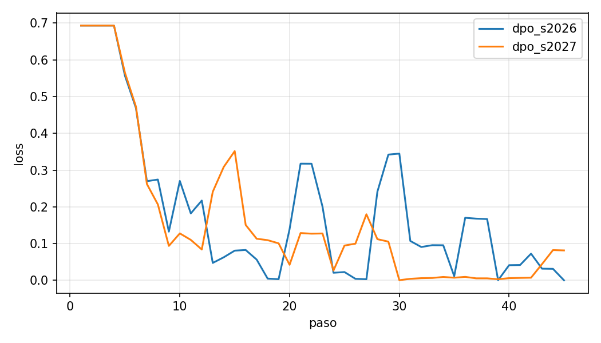
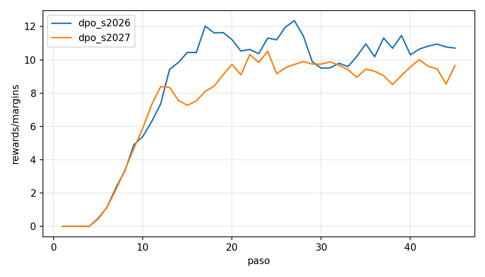
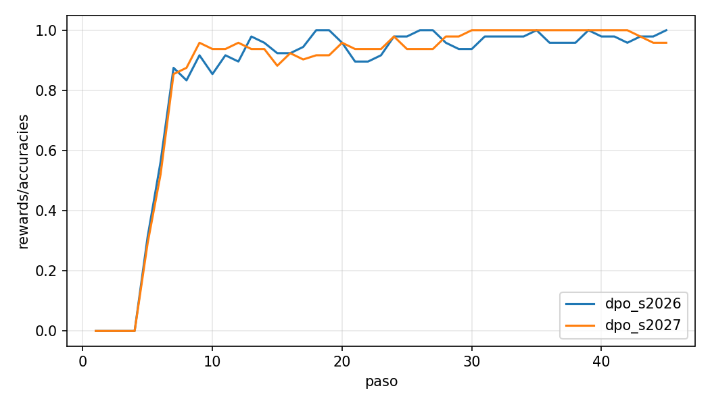

# DPO de Qwen3-1.7B en Kaggle (camino 5)

**Ninguna semilla mejora al base en `eval`.** pass@1 de 51/90 (semilla 2026) y 56/90 (semilla 2027), frente a 53/90 del base medido en Kaggle con el mismo código (`results/grpo_kaggle/eval_pass1/base`). Pareado por instancia: 10 ganadas y 12 perdidas (McNemar exacto, p = 0,83) y 13 y 10 (p = 0,68).

## Entrenamiento

`notebooks/dpo_kaggle.ipynb` ([ejecución](dpo_kaggle_ejecutado.ipynb)), dos T4, una semilla por GPU. Pares de `results/datos_combinados/dpo.jsonl` (commit 7dd2db8), condición `visible` **con los tres niveles, hard incluido**: 262 pares, 230 tras descartar los que no caben en 4.096 tokens. 3 épocas, 45 pasos de 16 pares, tasa 2e-5, β = 0,1. 78 min (2026) y 68 min (2027).

| Semilla | Pérdida, 1er → último tercio | Exactitud de preferencia | Margen |
|---|---|---|---|
| 2026 | 0,319 → 0,068 | 0,66 → 0,98 | 4,77 → 10,55 |
| 2027 | 0,339 → 0,022 | 0,66 → 0,99 | 4,30 → 9,41 |

La exactitud llega a ~0,9 antes del fin de la primera época y queda en 1 en la segunda y la tercera: el modelo separa (memoriza) los 230 pares.

  

## Evaluación en `eval`

`notebooks/evaluar_grpo_kaggle.ipynb` con `METODO = "dpo"`, el código de `results/grpo_kaggle/codigo_grpo_kaggle.zip`, 1 muestra, 4.096 tokens. Resultados en [eval_pass1/](eval_pass1/resumen.md).

| Modelo | Easy | Medium | Hard | pass@1 |
|---|---:|---:|---:|---:|
| Base (Kaggle) | 24/30 | 19/30 | 10/30 | 53/90 |
| DPO s2026 | 23/30 | 19/30 | 9/30 | 51/90 |
| DPO s2027 | 23/30 | 22/30 | 11/30 | 56/90 |

Hard no mejora aunque DPO lo vio. Composición medium pasa de 0 a 3 y 4 de 10. Las respuestas cortadas en el tope suben de 2 a 5 y 7.

Los adaptadores (`resultados_dpo.zip`, 127 MB) no están en el repo; quedaron en el Output del cuaderno en Kaggle.
