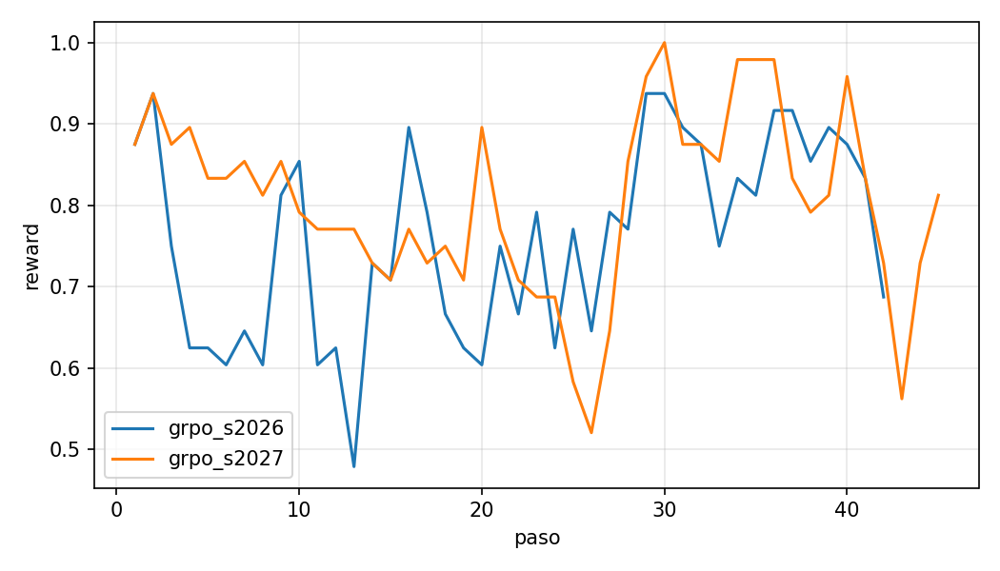
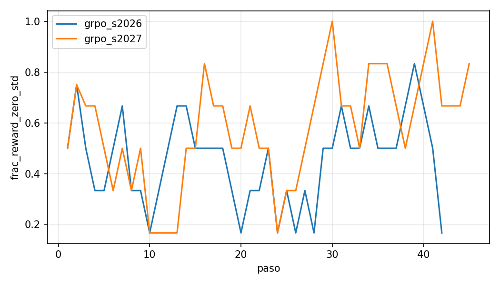

# Primeras corridas de GRPO con Qwen3-1.7B

## Evaluación del piloto

**El piloto entregó las curvas de recompensa solicitadas para la Entrega 2.** Las dos corridas terminaron con código 0, produjeron curvas de recompensa y mostraron que el verificador entrega señal a GRPO. La recompensa media subió del primer al último tercio en ambas semillas. El aumento fue más claro en la semilla 2026. La mejora en preguntas nuevas sigue pendiente de evaluación.

## Configuración

Se entrenó Qwen3-1.7B desde el modelo original con GRPO y LoRA, en dos corridas independientes, con una Tesla T4 por semilla. Se usaron problemas de inventario con datos visibles, de dificultad easy y medium. Había 240 problemas disponibles en esos niveles del conjunto de entrenamiento. Cada semilla tuvo un presupuesto de 150 minutos de entrenamiento y un límite de 2.048 tokens por respuesta. El notebook registró 155 minutos hasta el cierre del entrenamiento.

Cada paso usó dos problemas y generó ocho respuestas por problema. El verificador asignó 1 a cada respuesta correcta y 0 a las demás. La recompensa de cada paso corresponde a la fracción de aciertos entre sus 16 respuestas.

## Recompensa durante el entrenamiento

| Semilla | Pasos | Aciertos totales | Primer tercio | Segundo tercio | Último tercio | Cambio primer → último |
|---|---:|---:|---:|---:|---:|---:|
| 2026 | 42 | 505/672 (75,1 %) | 68,3 % | 73,7 % | 83,5 % | +15,2 pp |
| 2027 | 45 | 580/720 (80,6 %) | 80,8 % | 77,1 % | 83,8 % | +2,9 pp |

La semilla 2026 subió en los tres tramos. La semilla 2027 empezó más alto, bajó en el tramo intermedio y se recuperó en el último. Ambas quedaron cerca del 84 % en el tercio final. El gráfico usa un promedio móvil de tres pasos. Los valores de la tabla se calcularon con la serie sin suavizar.



## Señal de GRPO y límite de generación

| Semilla | Grupos sin señal | Grupos con señal | Respuestas que llegaron al límite | Tiempo medio por paso |
|---|---:|---:|---:|---:|
| 2026 | 37/84 (44,0 %) | 47/84 (56,0 %) | 68/672 (10,1 %) | 212 s |
| 2027 | 52/90 (57,8 %) | 38/90 (42,2 %) | 78/720 (10,8 %) | 201 s |

**85 de 174 grupos (48,9 %) tuvieron una mezcla de aciertos y errores.** GRPO usa esa diferencia entre respuestas al mismo problema. Si las ocho respuestas de un grupo reciben la misma recompensa, incluso si todas fueron correctas, ese grupo no aporta señal relativa. En el segundo gráfico, un valor menor indica más grupos con diferencias de recompensa.

**146 de 1.392 respuestas (10,5 %) llegaron al tope de generación.** Es un límite relevante para interpretar el piloto. Con estos agregados queda abierta la causa de cada fallo individual.



## Qué se puede afirmar en la Entrega 2

Las dos curvas documentan los primeros entrenamientos y muestran que el entorno ofrece señal. Como cada paso usa dos problemas, la dificultad de esos problemas también hace variar la recompensa. Los tercios agregan lotes distintos de train.

Para medir cuánto mejoró el modelo en casos nuevos, comparen al Qwen original y a cada adaptador sobre la misma partición eval, con las mismas preguntas, configuración de generación y verificador. La línea base visible del proyecto en eval fue **58/90 en pass@1 (64,4 %) y 80/90 en pass@5 (88,9 %)**. La eventual mejora se debe medir entre valores de pass@k en eval. Los porcentajes de las curvas son tasas de acierto de respuestas generadas durante train.

La corrida usó datos visibles. Para medir un efecto sobre el uso de herramientas haría falta una evaluación específica en esa condición. Las métricas disponibles tampoco permiten determinar si hubo casos de explotación del verificador. Eso requiere revisar muestras de respuestas premiadas.

## Cómo continuar desde el repositorio

[Notebook de entrenamiento](../../notebooks/grpo_curva_kaggle.ipynb) · [Notebook ejecutado](qwen-grpo.ipynb) · [Log de Kaggle](qwen-grpo.log) · [Métricas por paso](metricas_por_paso.json)

El [ZIP original de Kaggle](resultados_grpo.zip) se guarda con Git LFS. Contiene los pesos LoRA de las semillas 2026 y 2027, las muestras de respuestas, los manifiestos y los registros de entrenamiento. Para traerlo en esta rama, instala Git LFS y ejecuta:

```bash
git lfs install
git switch entrega-2
git pull --ff-only
git lfs pull
```

Para medir los adaptadores, abre [el notebook de evaluación](../../notebooks/evaluar_grpo_kaggle.ipynb) en Kaggle y agrega los dos ZIP como entrada: [código de la corrida](codigo_grpo_kaggle.zip) y [resultados con los adaptadores](resultados_grpo.zip). El notebook evalúa primero con un intento por pregunta. Se puede configurar para medir cinco intentos.
