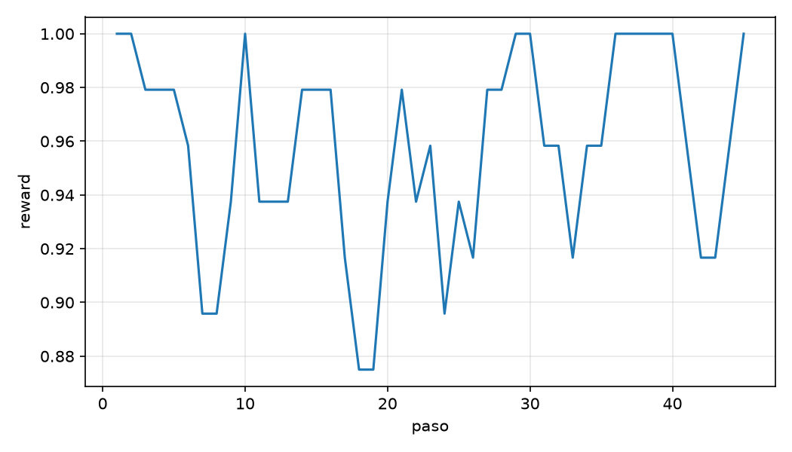
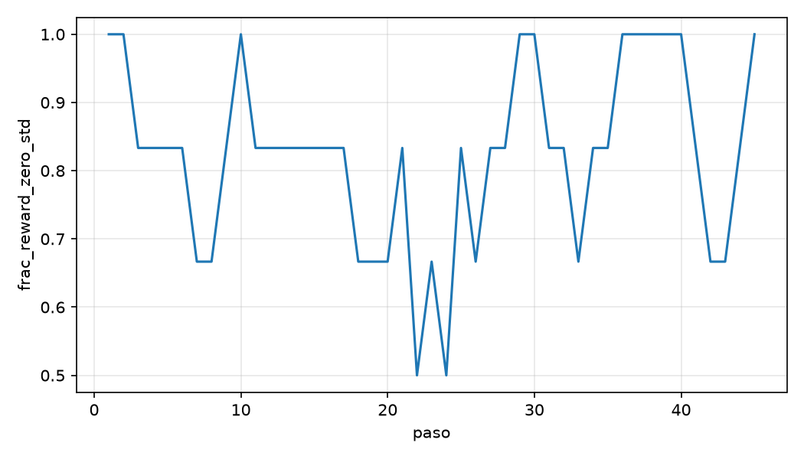

# SFT seguido de GRPO en Peteroa (camino 3)

**45 pasos de GRPO sobre el adaptador del SFT no cambian el resultado en `eval`: pass@1 de 75/90 frente a 76/90 del SFT, y pass@5 igual, 81/90.** Pareado por instancia, SFT → GRPO gana 3 y pierde 4 frente al SFT (McNemar exacto, p = 1). Frente al base sigue siendo mejor: 75/90 contra 64/90 (gana 13 y pierde 2, p = 0,007). La causa está en el entrenamiento: el SFT ya acierta el 96 % de easy y medium, y el 82 % de los grupos de GRPO no tienen señal.

Trabajo SLURM 11453, 25 de noviembre de 2026, una H100 80 GB. Comando completo en [`grpo_desde_sft.sbatch`](grpo_desde_sft.sbatch) y salida en [`grpo-desde-sft-11453.log`](grpo-desde-sft-11453.log).

## Configuración

Misma configuración que el piloto GRPO desde el base en Kaggle ([camino 4](../grpo_kaggle/README.md)), salvo el punto de partida:

- **Punto de partida:** el adaptador LoRA del SFT ([`results/sft_peteroa`](../sft_peteroa/README.md)). GRPO sigue entrenando ese mismo adaptador.
- **Prompts:** los 240 de easy y medium de `data/train_extra.jsonl` (`make_train_prompts.py --n-per-cell 40`, semilla 5151), en condición `visible`. Hard queda fuera.
- **GRPO:** 8 respuestas por prompt, 2 prompts por paso (16 respuestas), 2.048 tokens por respuesta, tasa 2e-5, `loss_type` dapo, β = 0, temperatura 0,7, semilla 2026.
- **Duración:** 45 pasos, como el piloto (42 y 45 pasos). Tomó 47 minutos, unos 63 s por paso.

## Recompensa durante el entrenamiento

| Tramo | Recompensa media | Grupos sin señal |
|---|---:|---:|
| Primer tercio | 0,958 | 83 % |
| Segundo tercio | 0,946 | 77 % |
| Último tercio | 0,967 | 87 % |
| **Total** | **0,957 (689/720)** | **82 %** |

El eje vertical va de 0,87 a 1,0: la curva parece oscilar mucho, pero se mueve en torno a 0,95 sin subir. En el piloto desde el base, la recompensa subía de 0,68–0,81 a 0,84 y cerca de la mitad de los grupos tenía señal. Aquí, 4 de cada 5 grupos tienen las 8 respuestas correctas y no aportan gradiente. Solo el 1,5 % de las respuestas llega al tope de 2.048 tokens (10,5 % en el piloto), con un largo medio de 777 tokens.

## Evaluación en `eval`

Mismo protocolo que el SFT y el base de [`results/sft_peteroa`](../sft_peteroa/README.md): las 90 instancias `visible` de la línea base (huella `efb77852…`), thinking, 4.096 tokens y 5 muestras. El base y el SFT se midieron en el trabajo 11447, con la misma GPU y el mismo código.

| Nivel | Base pass@1 | SFT pass@1 | SFT → GRPO pass@1 | Base pass@5 | SFT pass@5 | SFT → GRPO pass@5 |
|---|---:|---:|---:|---:|---:|---:|
| easy | 26/30 | 29/30 | 30/30 | 30/30 | 30/30 | 30/30 |
| medium | 25/30 | 30/30 | 28/30 | 28/30 | 30/30 | 30/30 |
| hard (no entrenado) | 13/30 | 17/30 | 17/30 | 22/30 | 21/30 | 21/30 |
| **Total** | **64/90** | **76/90** | **75/90** | **80/90** | **81/90** | **81/90** |

- **Contra el SFT:** gana 3 instancias y pierde 4 en pass@1 (p = 1). En pass@5 no hay ninguna diferencia.
- **Aciertos por muestra:** 286/450 en el base, 380/450 en el SFT y 384/450 en SFT → GRPO.
- **Hard por familia (pass@1):** availability 6 / 10 / 9, selection 6 / 7 / 8, composition 1 / 0 / 0 (base / SFT / SFT → GRPO).
- **Errores por muestra:** valor equivocado 138 / 67 / 61, y sin bloque `<answer>` 15 / 3 / 5.

## Lectura

Con este presupuesto, el GRPO no le suma nada medible al SFT. La razón es la señal: el GRPO compara respuestas de un mismo problema, y en easy y medium el SFT casi nunca falla. No es una conclusión sobre GRPO en general. Para darle señal hay varias opciones, todas con un costo:

- **Entrenar con hard.** Es donde el SFT todavía falla (17/30), pero así hard deja de ser un nivel no visto.
- **Filtrar o reponer los grupos sin señal** (la ablación tipo DAPO de la propuesta).
- **Más pasos o más prompts por paso.**

Falta la versión comparable con el GRPO desde el base, con el mismo hardware y la misma evaluación de 5 muestras: el piloto de Kaggle se midió con 1 muestra y otro base (53/90).

## Archivos

| Archivo | Contenido |
|---|---|
| `adaptador_sft_grpo.zip` (Git LFS) | Adaptador LoRA final (SFT + GRPO) y tokenizador |
| `curva_recompensa.png`, `curva_senal.png` y sus `.csv` | Curvas (promedio móvil de 3 pasos) |
| `log.jsonl`, `train_log.json` | Métricas por paso |
| `reward_errors.jsonl`, `completions.jsonl` | Tipos de error acumulados y 1 de cada 4 respuestas del entrenamiento |
| `manifest.json` | Argumentos, versiones y recompensa total |
| `eval_sft_grpo/` | Rollouts, `report.md`, `summary.json` y muestra de errores de la evaluación |
| `grpo_desde_sft.sbatch`, `grpo-desde-sft-11453.log` | Trabajo SLURM y su salida |
