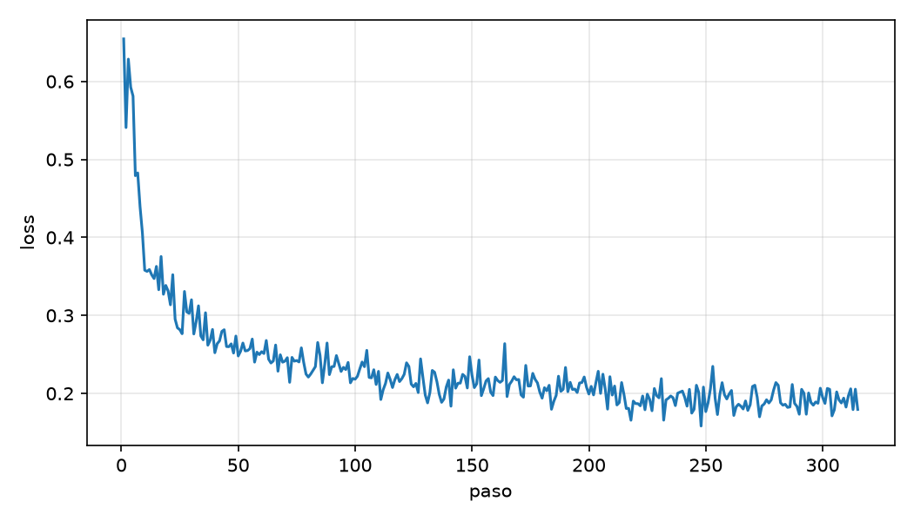

# SFT de Qwen3-1.7B en Peteroa (camino 2)

**El SFT sube el pass@1 en `eval` de 64/90 a 76/90 (McNemar exacto, p = 0,012), pero el pass@5 casi no cambia (80/90 a 81/90).** El modelo no aprende a resolver preguntas nuevas: se vuelve más consistente en las que ya podía resolver con varios intentos. En hard, que no se usó para entrenar, el pass@1 sube de 13/30 a 17/30. Composición hard sigue sin resolverse.

Trabajo SLURM 11447, 25 de noviembre de 2026, una H100 80 GB. Comando completo en [`sft_y_eval.sbatch`](sft_y_eval.sbatch) y salida en [`sft-visible-em-11447.log`](sft-visible-em-11447.log).

## Configuración

- **Datos:** `results/datos_combinados/sft.jsonl`, condición `visible`, niveles easy y medium: 1.666 trazas correctas (1.664 del Qwen3-8B con thinking y 2 del Qwen3-1.7B), todas de instancias de `train`. Ninguna se descartó por largo (tope de 8.192 tokens).
- **Modelo:** Qwen3-1.7B con LoRA (r = 16, alfa = 32, dropout 0,05, todas las capas lineales): 17,4 M de parámetros entrenables (1 %).
- **Entrenamiento:** 3 épocas, 315 pasos, 16 trazas por paso (2 por pasada × 8 de acumulación), tasa 2e-4 con coseno y 5 % de calentamiento, bf16, gradient checkpointing, semilla 2026. Duró 13 minutos.
- **La pérdida cae solo en la respuesta del asistente** (razonamiento y `<answer>`), no en el prompt.

## Curva de pérdida

| Época | Pérdida media |
|---|---:|
| 1 | 0,290 |
| 2 | 0,212 |
| 3 | 0,192 |

Baja rápido en los primeros 15 pasos (de 0,65 a 0,35) y después lento. Entre la segunda y la tercera época mejora poco, así que no hacía falta entrenar más. La pérdida mide cuánto se parece el modelo a las trazas del 8B, no si acierta. No hay pérdida de validación.

## Evaluación en `eval`

Mismo protocolo para los dos modelos, en el mismo trabajo y la misma GPU: las 90 instancias de `eval` de la línea base (huella `efb77852…`), condición `visible`, thinking activado, 4.096 tokens por respuesta y 5 muestras por instancia. pass@1 usa la muestra 0.

| Nivel | Base pass@1 | SFT pass@1 | Base pass@5 | SFT pass@5 |
|---|---:|---:|---:|---:|
| easy | 26/30 | 29/30 | 30/30 | 30/30 |
| medium | 25/30 | **30/30** | 28/30 | 30/30 |
| hard (no entrenado) | 13/30 | **17/30** | 22/30 | 21/30 |
| **Total** | **64/90** | **76/90** | **80/90** | **81/90** |

- **pass@1:** el SFT gana 16 instancias y pierde 4 (McNemar exacto, p = 0,012).
- **pass@5:** gana 2 y pierde 1. No hay diferencia.
- **Aciertos por muestra:** 286/450 (64 %) en el base y 380/450 (84 %) en el SFT.
- **Hard por familia (pass@1):** availability 6 → 10, selection 6 → 7, composition 1 → 0.
- **Errores (por muestra):** valor equivocado 138 → 67 y sin bloque `<answer>` 15 → 3. El SFT casi siempre responde con el formato pedido.

El base reevaluado aquí da 64/90 en pass@1 y 80/90 en pass@5. La línea base del Desafío dio 58/90 y 80/90, y el base reevaluado en Kaggle para GRPO, 53/90 (otra GPU y 1 muestra). Las diferencias de pass@1 entre corridas del mismo modelo muestran cuánto varía una sola muestra; por eso la comparación válida es la de esta tabla, con los dos modelos en el mismo trabajo.

**No comparar directamente con el GRPO de Kaggle** (69/90 y 67/90): ese GRPO se entrenó con 2.048 tokens por respuesta, unos 45 pasos y otra GPU, y se midió contra un base de 53/90.

## Archivos

| Archivo | Contenido |
|---|---|
| `adaptador_sft_visible_em.zip` (Git LFS) | Adaptador LoRA y tokenizador. Se usa con `run_pilot.py --adapter` o `train_grpo.py --init-adapter` |
| `curva_perdida.png`, `curva_perdida.csv`, `train_log.json` | Pérdida por paso |
| `manifest.json` | Argumentos, versiones y huella de los datos del entrenamiento |
| `eval_sft/`, `eval_base/` | Rollouts, `report.md`, `summary.json` y muestra de errores de cada modelo |
| `sft_y_eval.sbatch`, `sft-visible-em-11447.log` | Trabajo SLURM y su salida |

## Para correrlo de nuevo en Peteroa

- El `/home` de la cuenta tiene 50 GB y estaba casi lleno: el entorno, la caché de Hugging Face y los temporales van en `/workspace1/grupo5-iagenerativa` (200 GB).
- `sbatch` exige `#SBATCH --comment="..."` y `#SBATCH --qos=regular` (máximo 1 día).
- Con 8 trazas por pasada y 8.192 tokens se queda sin memoria en una H100. Con 2 por pasada y gradient checkpointing usa bien la GPU.

## Siguiente paso

GRPO desde este adaptador (camino 3), con la misma configuración que el GRPO desde el base (camino 4), para comparar los dos con el mismo presupuesto.
